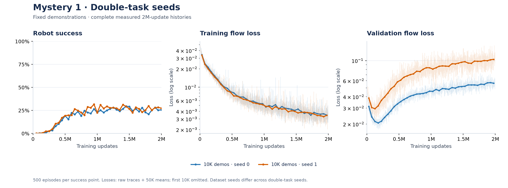
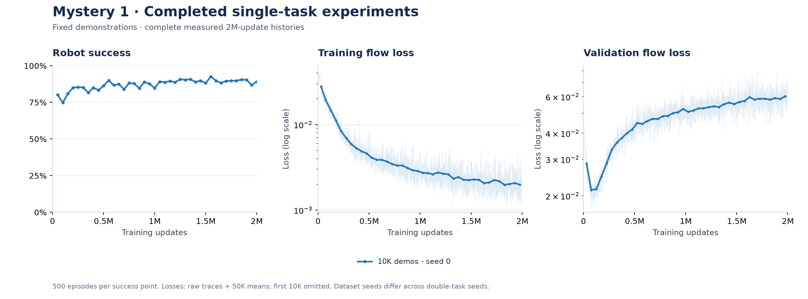

# Mystery 1 and 4: completed experiments

**7 of 10 experiments have completed 2,000,000 updates and final 500-episode evaluations.** The four main M4 conditions are complete. Additional completed M1 results, plots and per-experiment NPZ files are included below; unfinished experiments are excluded from final comparisons.

## Run configuration

The original five-run comparison uses **state-based `block-double-task1-v0`**, seed 0, and **2M optimizer updates**. Additional M1 runs use the same model/optimizer settings; their task, demonstration count and seed are listed below. The policy is OCBench flow behavioral cloning: an 8-layer residual MLP with 4,096 units per layer and layer normalization, float32 computation, Adam at learning rate `1e-4`, and batch size 1,024. It predicts 25-action chunks using 10 flow integration steps. Robot success is measured over 500 rollout episodes per evaluation.

- **M1:** reuse one fixed dataset of nominally 10,000 demonstration episodes.
- **M4:** generate fresh batches of nominally 1,000 demonstration episodes, using each training starting point at most once per collection. Compare handcrafted state inputs, frozen z-score standardization, and standardized XYZ coordinates multiplied by 0.1 or 10.
- **Validation:** nominally 128 held-out episodes; demonstration datasets retain successful episodes. M4's fixed-set scores below average 32 batches per checkpoint.

[Exact commands and implementation details](OCBENCH_COMMANDS.md) · [Short configuration guide](EXPERIMENT_GUIDE.md)

## Mystery 1: loss and control can disagree


Final robot success: **25.8%**. Validation flow loss reached its minimum **0.01752 at 182,000 updates**, then rose to **0.05617 at 2M** (3.21×). Final training flow loss was 0.00337; validation action MSE was 0.01460.

This completed run supports the observation that worsening validation flow loss need not mean worsening robot control. It does not prove that overfitting causes better control or establish robustness across training seeds. The single-task dataset-size comparison is a separate question.

<!-- COMPLETED_EXTRAS_START -->
### Additional completed M1 experiments





| Task | Nominal demonstrations | Seed | Final success | Train flow | Val flow | Val action MSE |
| --- | ---: | ---: | ---: | ---: | ---: | ---: |
| Double | 10,000 | 0 | 25.8% | 0.00337 | 0.05617 | 0.01460 |
| Double | 10,000 | 1 | 27.4% | 0.00329 | 0.09256 | 0.04761 |
| Single | 10,000 | 0 | 89.2% | 0.00132 | 0.06189 | 0.01467 |

Every row has completed 2M updates and a final 500-episode rollout. Double-task seeds 0 and 1 use different demonstration seeds as well as training seeds; they are not a controlled training-seed-only comparison. Single-task and double-task success are different tasks. A 10K-versus-50K comparison is reported only after both single-task runs finish. Continuations follow checkpoint ancestry and exclude discarded post-checkpoint updates.

<!-- COMPLETED_EXTRAS_END -->

## Mystery 4: scaling affects behavior much more than the training scores suggest


All four rows below are evaluated at **the same 2M optimizer updates**, using 500 robot attempts each. These remain single-seed results; checkpoint evaluations are not independent training seeds.

| Input | Final success | Train flow | Fixed-set val flow | Fixed-set val action MSE |
| --- | ---: | ---: | ---: | ---: |
| [handcrafted](results/runs/m4-handcrafted-s0-cont2/README.md) | 56.4% | 0.01347 | 0.01296 | 0.01380 |
| [standardized](results/runs/m4-standardized-s0-cont2/README.md) | 54.0% | 0.01318 | 0.01295 | 0.01399 |
| [xyz0.1](results/runs/m4-xyz0.1-s0-cont2/README.md) | 6.4% | 0.01352 | 0.01327 | 0.01434 |
| [xyz10](results/runs/m4-xyz10-s0-cont2/README.md) | 55.0% | 0.01265 | 0.01291 | 0.01290 |

The observed final success spread is **50.0 percentage points**: handcrafted is highest and xyz0.1 lowest in this seed. Use the measured losses in the table rather than assuming they are identical. This comparison describes the observed effect; it does not prove a distribution-shift mechanism or a universal ranking.

### Validation on one fixed held-out set


Validation scores use the same seed-defined held-out dataset for every condition and checkpoint, averaging 32 batches of 1,024 transitions. The validation figure shows measured saved checkpoints; training and robot-success curves cover the full run through 2M. Training-loss curves show raw measurements and 50K-update means. Each M4 NPZ includes full logged histories (`history__*`), ready-to-plot fixed-set validation arrays (`fixed_validation__*`), and the complete audit (`audit__*`). The plotted fixed-set series has no validation-set switch at resume.

## Download the complete original plot measurements

Each completed experiment has a compressed, pickle-free NPZ with full unsmoothed training/success histories, configuration, and checkpoint ancestry. Historical measurements remain lossless.

| Experiment | Complete NPZ | Compressed size |
| --- | --- | ---: |
| m1-double-n10000-s0 | [Download](results/plot-data/m1-double-n10000-s0.npz) | 422.8 KiB |
| m4-handcrafted-s0 | [Download](results/plot-data/m4-handcrafted-s0.npz) | 672.3 KiB |
| m4-standardized-s0 | [Download](results/plot-data/m4-standardized-s0.npz) | 677.4 KiB |
| m4-xyz0.1-s0 | [Download](results/plot-data/m4-xyz0.1-s0.npz) | 671.3 KiB |
| m4-xyz10-s0 | [Download](results/plot-data/m4-xyz10-s0.npz) | 671.1 KiB |
| m1-double-n10000-s1 | [Download](results/plot-data/m1-double-n10000-s1.npz) | 424.5 KiB |
| m1-single-n10000-s0 | [Download](results/plot-data/m1-single-n10000-s0.npz) | 435.7 KiB |

Combined size: **3975.3 KiB**. [SHA-256 manifest](results/plot-data/manifest.json).

Recreate the figures using only the published NPZ files:

```bash
source scripts/env.sh
.venv/bin/python scripts/plot_from_npz.py --data results/plot-data --output .local/recreated-plots
```

**For the four main M4 conditions, use `fixed_validation__*`, which is exactly what the corrected validation figure plots.** Every point uses one shared regenerated held-out dataset (index 0, parallel 2500); only retained checkpoints were reevaluated. These are measured points, with no interpolation or rescaling. The dense historical validation cannot be repaired exactly because the old held-out arrays and intermediate checkpoints were not retained.

```python
import numpy as np
with np.load("results/plot-data/m4-handcrafted-s0.npz", allow_pickle=False) as d:
    validation_steps = d["fixed_validation__step"]
    validation_flow = d["fixed_validation__flow_loss"]
    validation_mse = d["fixed_validation__action_mse"]
    validation_se = d["fixed_validation__flow_loss_batch_se"]
    training_steps = d["history__metrics__step"]
    training_flow = d["history__metrics__training__flow_loss"]
    success_steps = d["history__eval__step"]
    success = d["history__eval__success"]
```

`history__metrics__validation__*` preserves the original logged scores, including the held-out-set change at resume; it is not the corrected validation figure. `audit__*` retains all three diagnostic datasets. M1 validation uses its original `history__metrics__validation__*` arrays. [Validation audit and limitations](results/validation/M4_VALIDATION_AUDIT.md) · [Archive schema](scripts/plot_data.py).

## Reproduction limits and validation

These are state-based, finite-budget experiments, not image policies or a literal infinite-data limit. Our frozen z-score/scaling and one-use streaming policy differ from an exact numerical blog reproduction. See the [plain-language guide](EXPERIMENT_GUIDE.md), [native and wrapper commands](OCBENCH_COMMANDS.md), [original blog](https://seohong.me/blog/behavioral-cloning-mystery/), and [final checkpoint integrity checks](results/validation/final-five-checkpoints.json). Checkpoint files, robot data and private scheduler paths remain local.

[Full run catalog](results/runs/README.md) · [W&B](https://forge.coreweave.com/wandb/yzchhr/ocbench-bc-mysteries-1-4) · [Earlier performance experiments](results/profiling/README.md)

<!-- LIVE_RESULTS_START -->
## Live experiment status

[W&B project](https://forge.coreweave.com/wandb/yzchhr/ocbench-bc-mysteries-1-4) · [W&B run catalog](https://forge.coreweave.com/wandb/yzchhr/ocbench-bc-mysteries-1-4/runs/ocbench-catalog-v1)

Pilot runs validate execution only. Reproduction runs target 2,000,000 updates; partial single-seed curves support only the limited findings explained above.

| Run records | W&B | Updates | Train flow | Val flow | Val action MSE | Success | Eval update | Finished |
| --- | --- | ---: | ---: | ---: | ---: | ---: | ---: | --- |
| [m1-double-n10000-s0](results/runs/m1-double-n10000-s0/README.md) | [Charts](https://forge.coreweave.com/wandb/yzchhr/ocbench-bc-mysteries-1-4/runs/ocb7d868146415f56201) | 2000000 | 0.0034 | 0.0562 | 0.0146 | 0.2580 | 2000000 | yes |
| [m1-double-n10000-s1](results/runs/m1-double-n10000-s1/README.md) | [Charts](https://forge.coreweave.com/wandb/yzchhr/ocbench-bc-mysteries-1-4/runs/ocbe40e2aea73f9d4663) | 2000000 | 0.0033 | 0.0926 | 0.0476 | 0.2740 | 2000000 | yes |
| [m1-single-n10000-s0](results/runs/m1-single-n10000-s0/README.md) | [Charts](https://forge.coreweave.com/wandb/yzchhr/ocbench-bc-mysteries-1-4/runs/ocbc917128d7081f944a) | 1118000 | 0.0033 | 0.0640 | 0.0124 | 0.8880 | 1100000 | no |
| [m1-single-n10000-s0-cont1](results/runs/m1-single-n10000-s0-cont1/README.md) | [Charts](https://forge.coreweave.com/wandb/yzchhr/ocbench-bc-mysteries-1-4/runs/ocb45bf280c7ad3312b8) | 2000000 | 0.0013 | 0.0619 | 0.0147 | 0.8920 | 2000000 | yes |
| [m1-single-n50000-s0](results/runs/m1-single-n50000-s0/README.md) | [Charts](https://forge.coreweave.com/wandb/yzchhr/ocbench-bc-mysteries-1-4/runs/ocb85c79ff83a5c3d368) | 1021000 | 0.0067 | 0.0240 | 0.0140 | 0.8140 | 1000000 | no |
| [m1-single-n50000-s0-cont1](results/runs/m1-single-n50000-s0-cont1/README.md) | pending upload | 0 | — | — | — | — | — | no |
| [m1-single-n50000-s0-cont2](results/runs/m1-single-n50000-s0-cont2/README.md) | pending upload | 0 | — | — | — | — | — | no |
| [m1-single-n50000-s0-cont3](results/runs/m1-single-n50000-s0-cont3/README.md) | pending upload | 1003000 | 0.0083 | 0.0199 | 0.0122 | — | — | no |
| [m4-fourier1-s0](results/runs/m4-fourier1-s0/README.md) | [Charts](https://forge.coreweave.com/wandb/yzchhr/ocbench-bc-mysteries-1-4/runs/ocb9ed5754b980da256e) | 601000 | 0.0181 | 0.0133 | 0.0125 | 0.0480 | 600000 | no |
| [m4-fourier1-s0-cont1](results/runs/m4-fourier1-s0-cont1/README.md) | pending upload | 0 | — | — | — | — | — | no |
| [m4-fourier1-s0-cont2](results/runs/m4-fourier1-s0-cont2/README.md) | pending upload | 0 | — | — | — | — | — | no |
| [m4-fourier1-s0-cont3](results/runs/m4-fourier1-s0-cont3/README.md) | pending upload | 601000 | 0.0164 | 0.0158 | 0.0146 | — | — | no |
| [m4-fourier4-s0](results/runs/m4-fourier4-s0/README.md) | [Charts](https://forge.coreweave.com/wandb/yzchhr/ocbench-bc-mysteries-1-4/runs/ocb628936cae54ff280c) | 602000 | 0.0137 | 0.0161 | 0.0125 | 0.0740 | 600000 | no |
| [m4-fourier4-s0-cont1](results/runs/m4-fourier4-s0-cont1/README.md) | pending upload | 0 | — | — | — | — | — | no |
| [m4-fourier4-s0-cont2](results/runs/m4-fourier4-s0-cont2/README.md) | pending upload | 0 | — | — | — | — | — | no |
| [m4-fourier4-s0-cont3](results/runs/m4-fourier4-s0-cont3/README.md) | pending upload | 601000 | 0.0154 | 0.0160 | 0.0140 | — | — | no |
| [m4-handcrafted-s0](results/runs/m4-handcrafted-s0/README.md) | [Charts](https://forge.coreweave.com/wandb/yzchhr/ocbench-bc-mysteries-1-4/runs/ocb6555c1eef3e7c6a5b) | 1468000 | 0.0118 | 0.0162 | 0.0170 | 0.5760 | 1450000 | no |
| [m4-handcrafted-s0-cont1](results/runs/m4-handcrafted-s0-cont1/README.md) | [Charts](https://forge.coreweave.com/wandb/yzchhr/ocbench-bc-mysteries-1-4/runs/ocb89ddace69a79a65f6) | 1160000 | 0.0132 | 0.0140 | 0.0150 | 0.5660 | 1150000 | no |
| [m4-handcrafted-s0-cont2](results/runs/m4-handcrafted-s0-cont2/README.md) | [Charts](https://forge.coreweave.com/wandb/yzchhr/ocbench-bc-mysteries-1-4/runs/ocb84f0a7faf0b586cf8) | 2000000 | 0.0135 | 0.0159 | 0.0192 | 0.5640 | 2000000 | yes |
| [m4-standardized-s0](results/runs/m4-standardized-s0/README.md) | [Charts](https://forge.coreweave.com/wandb/yzchhr/ocbench-bc-mysteries-1-4/runs/ocbdf09e0125b1d85354) | 1500000 | 0.0131 | 0.0132 | 0.0131 | 0.5000 | 1450000 | no |
| [m4-standardized-s0-cont1](results/runs/m4-standardized-s0-cont1/README.md) | [Charts](https://forge.coreweave.com/wandb/yzchhr/ocbench-bc-mysteries-1-4/runs/ocb33979b4ad2b65ef78) | 1161000 | 0.0148 | 0.0121 | 0.0132 | 0.3260 | 1150000 | no |
| [m4-standardized-s0-cont2](results/runs/m4-standardized-s0-cont2/README.md) | [Charts](https://forge.coreweave.com/wandb/yzchhr/ocbench-bc-mysteries-1-4/runs/ocb8c6d9298a4314bda4) | 2000000 | 0.0132 | 0.0173 | 0.0202 | 0.5400 | 2000000 | yes |
| [m4-xyz0.1-s0](results/runs/m4-xyz0.1-s0/README.md) | [Charts](https://forge.coreweave.com/wandb/yzchhr/ocbench-bc-mysteries-1-4/runs/ocbb5e56eb1e20d223a2) | 1473000 | 0.0112 | 0.0151 | 0.0187 | 0.0260 | 1450000 | no |
| [m4-xyz0.1-s0-cont1](results/runs/m4-xyz0.1-s0-cont1/README.md) | [Charts](https://forge.coreweave.com/wandb/yzchhr/ocbench-bc-mysteries-1-4/runs/ocbf86da02146d369276) | 1161000 | 0.0147 | 0.0124 | 0.0149 | 0.0080 | 1150000 | no |
| [m4-xyz0.1-s0-cont2](results/runs/m4-xyz0.1-s0-cont2/README.md) | [Charts](https://forge.coreweave.com/wandb/yzchhr/ocbench-bc-mysteries-1-4/runs/ocb608bbd66f8b803e14) | 2000000 | 0.0135 | 0.0167 | 0.0201 | 0.0640 | 2000000 | yes |
| [m4-xyz10-s0](results/runs/m4-xyz10-s0/README.md) | [Charts](https://forge.coreweave.com/wandb/yzchhr/ocbench-bc-mysteries-1-4/runs/ocb8f3a301437f09df88) | 1387000 | 0.0105 | 0.0208 | 0.0273 | 0.6120 | 1350000 | no |
| [m4-xyz10-s0-cont1](results/runs/m4-xyz10-s0-cont1/README.md) | [Charts](https://forge.coreweave.com/wandb/yzchhr/ocbench-bc-mysteries-1-4/runs/ocbdd22bed18f8358e0f) | 817000 | 0.0159 | 0.0142 | 0.0156 | — | — | no |
| [m4-xyz10-s0-cont2](results/runs/m4-xyz10-s0-cont2/README.md) | [Charts](https://forge.coreweave.com/wandb/yzchhr/ocbench-bc-mysteries-1-4/runs/ocb12b19a6ae9b86ff1f) | 2000000 | 0.0126 | 0.0145 | 0.0161 | 0.5500 | 2000000 | yes |

Blank evaluation cells mean no recorded evaluation yet. Undefined duration aggregates at zero success are stored as null; success itself remains zero.
<!-- LIVE_RESULTS_END -->
