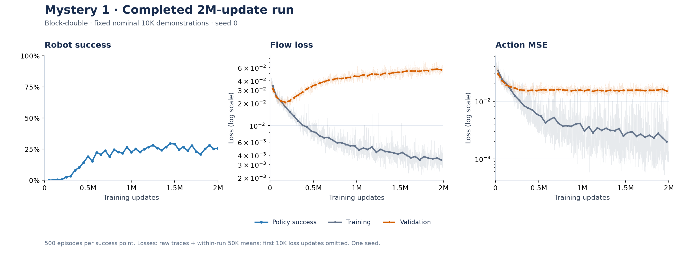
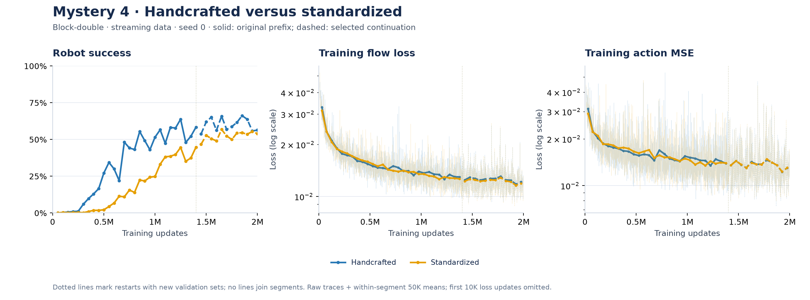
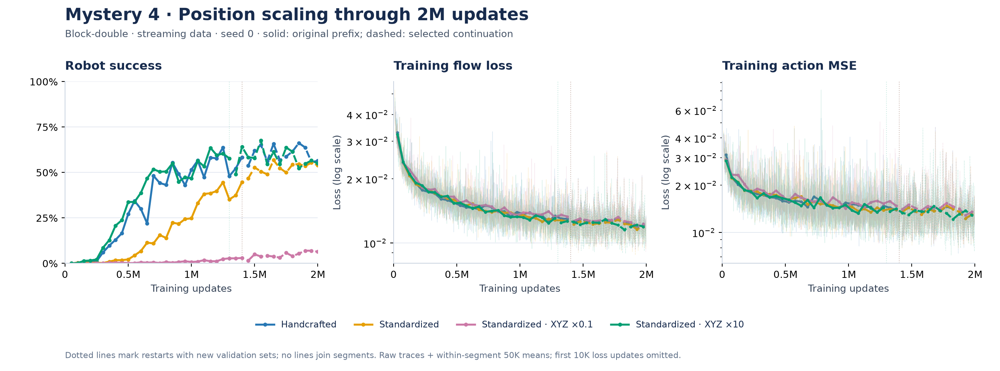
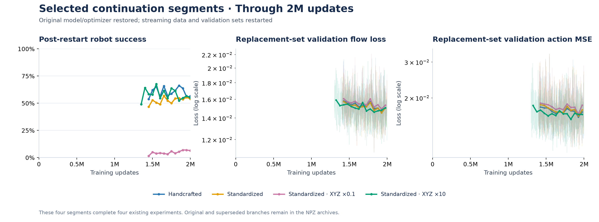

# Mystery 1 and 4: completed five-run results

The requested **M1 double-10K seed-0 run and four main M4 conditions have all completed 2,000,000 updates**, including final 500-episode rollout evaluations. Fourier variants and other M1 runs are separate experiments; see the live catalog below.

## Mystery 1: loss and control can disagree



Final robot success: **25.8%**. Validation flow loss reached its minimum **0.01752 at 182,000 updates**, then rose to **0.05617 at 2M** (3.21×). Final training flow loss was 0.00337; validation action MSE was 0.01460.

This completed run supports the observation that worsening validation flow loss need not mean worsening robot control. It does not prove that overfitting causes better control or establish robustness across training seeds. The single-task dataset-size comparison is a separate question.

## Mystery 4: scaling affects behavior much more than the training scores suggest





All four rows below are evaluated at **the same 2M optimizer updates**, using 500 robot attempts each. These remain single-seed results; checkpoint evaluations are not independent training seeds.

| Input | Final success | Train flow | Val flow | Val action MSE |
| --- | ---: | ---: | ---: | ---: |
| [handcrafted](results/runs/m4-handcrafted-s0-cont2/README.md) | 56.4% | 0.01347 | 0.01587 | 0.01920 |
| [standardized](results/runs/m4-standardized-s0-cont2/README.md) | 54.0% | 0.01318 | 0.01728 | 0.02016 |
| [xyz0.1](results/runs/m4-xyz0.1-s0-cont2/README.md) | 6.4% | 0.01352 | 0.01666 | 0.02012 |
| [xyz10](results/runs/m4-xyz10-s0-cont2/README.md) | 55.0% | 0.01265 | 0.01450 | 0.01609 |

The observed final success spread is **50.0 percentage points**: handcrafted is highest and xyz0.1 lowest in this seed. Use the measured losses in the table rather than assuming they are identical. This comparison describes the observed effect; it does not prove a distribution-shift mechanism or a universal ranking.

### Restart boundaries and how to read the curves



The first three M4 models resumed from 1.4M, and XYZ×10 from 1.3M. Model weights, optimizer, agent RNG and preprocessing were restored. Training streams, sampler and validation sets restarted. Solid lines show original source records only through those checkpoints; dashed lines show the selected continuation to 2M. Additional checkpoint recoveries, if any, are listed in archive metadata. Dotted lines mark restart boundaries. Validation lines are never joined across different held-out sets. Extra original-source tail records and superseded continuation branches are preserved in the archives, not averaged into the selected result.

Loss panels show faint raw records plus nonoverlapping 50K-update means within each segment, with logarithmic loss axes and the first 10K loss updates omitted. Success points are measured evaluations, not smoothed or extrapolated. No multi-seed uncertainty band is implied.

## Download the complete original plot measurements

Each NPZ is **compressed, lossless and pickle-free**: numeric arrays, every unsmoothed scalar record, configuration, and explicit segment/branch metadata. These are the full measurements used for plotting, not simulated robot demonstrations or model checkpoints. Historical branches remain separately identifiable.

| Experiment | Complete NPZ | Compressed size |
| --- | --- | ---: |
| m1-double-n10000-s0 | [Download](results/plot-data/m1-double-n10000-s0.npz) | 213.9 KiB |
| m4-handcrafted-s0 | [Download](results/plot-data/m4-handcrafted-s0.npz) | 443.1 KiB |
| m4-standardized-s0 | [Download](results/plot-data/m4-standardized-s0.npz) | 448.3 KiB |
| m4-xyz0.1-s0 | [Download](results/plot-data/m4-xyz0.1-s0.npz) | 443.2 KiB |
| m4-xyz10-s0 | [Download](results/plot-data/m4-xyz10-s0.npz) | 441.0 KiB |

Combined size: **1989.5 KiB**. [SHA-256 hashes and file manifest](results/plot-data/manifest.json).

Recreate the figures from only those five NPZ files (from the repository root):

```bash
source scripts/env.sh
.venv/bin/python scripts/plot_from_npz.py --data results/plot-data --output .local/recreated-plots
```

For direct NumPy access, use `np.load(filename, allow_pickle=False)`. `manifest_json` explains segment prefixes; numeric keys such as `s0__metrics__step` and `s0__metrics__validation__flow_loss` hold unsmoothed columns. `s0__metrics__jsonl` preserves full records including null/missing fields. The selected branch is recorded in the manifest. [Archive reader/exporter](scripts/plot_data.py) documents the schema.

## Reproduction limits and validation

These are state-based, finite-budget experiments, not image policies or a literal infinite-data limit. Our frozen z-score/scaling, one-use streaming policy and restarted validation sets differ from an exact numerical blog reproduction. See the [plain-language guide](EXPERIMENT_GUIDE.md), [native and wrapper commands](OCBENCH_COMMANDS.md), [original blog](https://seohong.me/blog/behavioral-cloning-mystery/), and [final checkpoint integrity checks](results/validation/final-five-checkpoints.json). Checkpoint files, robot data and private scheduler paths remain local.

[Full run catalog](results/runs/README.md) · [W&B](https://forge.coreweave.com/wandb/yzchhr/ocbench-bc-mysteries-1-4) · [Earlier performance experiments](results/profiling/README.md)

<!-- LIVE_RESULTS_START -->
## Live experiment status

[W&B project](https://forge.coreweave.com/wandb/yzchhr/ocbench-bc-mysteries-1-4) · [W&B run catalog](https://forge.coreweave.com/wandb/yzchhr/ocbench-bc-mysteries-1-4/runs/ocbench-catalog-v1)

Pilot runs validate execution only. Reproduction runs target 2,000,000 updates; partial single-seed curves support only the limited findings explained above.

| Run records | W&B | Updates | Train flow | Val flow | Val action MSE | Success | Eval update | Finished |
| --- | --- | ---: | ---: | ---: | ---: | ---: | ---: | --- |
| [m1-double-n10000-s0](results/runs/m1-double-n10000-s0/README.md) | [Charts](https://forge.coreweave.com/wandb/yzchhr/ocbench-bc-mysteries-1-4/runs/ocb7d868146415f56201) | 2000000 | 0.0034 | 0.0562 | 0.0146 | 0.2580 | 2000000 | yes |
| [m1-double-n10000-s1](results/runs/m1-double-n10000-s1/README.md) | [Charts](https://forge.coreweave.com/wandb/yzchhr/ocbench-bc-mysteries-1-4/runs/ocbe40e2aea73f9d4663) | 1709000 | 0.0031 | 0.0933 | 0.0503 | 0.2320 | 1700000 | no |
| [m1-single-n10000-s0](results/runs/m1-single-n10000-s0/README.md) | [Charts](https://forge.coreweave.com/wandb/yzchhr/ocbench-bc-mysteries-1-4/runs/ocbc917128d7081f944a) | 743000 | 0.0026 | 0.0518 | 0.0129 | 0.8400 | 700000 | no |
| [m1-single-n50000-s0](results/runs/m1-single-n50000-s0/README.md) | [Charts](https://forge.coreweave.com/wandb/yzchhr/ocbench-bc-mysteries-1-4/runs/ocb85c79ff83a5c3d368) | 675000 | 0.0106 | 0.0148 | 0.0092 | 0.7880 | 650000 | no |
| [m4-fourier1-s0](results/runs/m4-fourier1-s0/README.md) | [Charts](https://forge.coreweave.com/wandb/yzchhr/ocbench-bc-mysteries-1-4/runs/ocb9ed5754b980da256e) | 400000 | 0.0186 | 0.0158 | 0.0164 | 0.0140 | 400000 | no |
| [m4-fourier4-s0](results/runs/m4-fourier4-s0/README.md) | [Charts](https://forge.coreweave.com/wandb/yzchhr/ocbench-bc-mysteries-1-4/runs/ocb628936cae54ff280c) | 400000 | 0.0180 | 0.0160 | 0.0163 | 0.0240 | 400000 | no |
| [m4-handcrafted-s0](results/runs/m4-handcrafted-s0/README.md) | [Charts](https://forge.coreweave.com/wandb/yzchhr/ocbench-bc-mysteries-1-4/runs/ocb6555c1eef3e7c6a5b) | 1468000 | 0.0118 | 0.0162 | 0.0170 | 0.5760 | 1450000 | no |
| [m4-handcrafted-s0-cont1](results/runs/m4-handcrafted-s0-cont1/README.md) | [Charts](https://forge.coreweave.com/wandb/yzchhr/ocbench-bc-mysteries-1-4/runs/ocb89ddace69a79a65f6) | 1160000 | 0.0132 | 0.0140 | 0.0150 | 0.5660 | 1150000 | no |
| [m4-handcrafted-s0-cont2](results/runs/m4-handcrafted-s0-cont2/README.md) | [Charts](https://forge.coreweave.com/wandb/yzchhr/ocbench-bc-mysteries-1-4/runs/ocb84f0a7faf0b586cf8) | 2000000 | 0.0135 | 0.0159 | 0.0192 | 0.5640 | 2000000 | yes |
| [m4-standardized-s0](results/runs/m4-standardized-s0/README.md) | [Charts](https://forge.coreweave.com/wandb/yzchhr/ocbench-bc-mysteries-1-4/runs/ocbdf09e0125b1d85354) | 1500000 | 0.0131 | 0.0132 | 0.0131 | 0.5000 | 1450000 | no |
| [m4-standardized-s0-cont1](results/runs/m4-standardized-s0-cont1/README.md) | [Charts](https://forge.coreweave.com/wandb/yzchhr/ocbench-bc-mysteries-1-4/runs/ocb33979b4ad2b65ef78) | 1161000 | 0.0148 | 0.0121 | 0.0132 | 0.3260 | 1150000 | no |
| [m4-standardized-s0-cont2](results/runs/m4-standardized-s0-cont2/README.md) | [Charts](https://forge.coreweave.com/wandb/yzchhr/ocbench-bc-mysteries-1-4/runs/ocb8c6d9298a4314bda4) | 2000000 | 0.0132 | 0.0173 | 0.0202 | 0.5400 | 2000000 | yes |
| [m4-xyz0.1-s0](results/runs/m4-xyz0.1-s0/README.md) | [Charts](https://forge.coreweave.com/wandb/yzchhr/ocbench-bc-mysteries-1-4/runs/ocbb5e56eb1e20d223a2) | 1473000 | 0.0112 | 0.0151 | 0.0187 | 0.0260 | 1450000 | no |
| [m4-xyz0.1-s0-cont1](results/runs/m4-xyz0.1-s0-cont1/README.md) | [Charts](https://forge.coreweave.com/wandb/yzchhr/ocbench-bc-mysteries-1-4/runs/ocbf86da02146d369276) | 1161000 | 0.0147 | 0.0124 | 0.0149 | 0.0080 | 1150000 | no |
| [m4-xyz0.1-s0-cont2](results/runs/m4-xyz0.1-s0-cont2/README.md) | [Charts](https://forge.coreweave.com/wandb/yzchhr/ocbench-bc-mysteries-1-4/runs/ocb608bbd66f8b803e14) | 2000000 | 0.0135 | 0.0167 | 0.0201 | 0.0640 | 2000000 | yes |
| [m4-xyz10-s0](results/runs/m4-xyz10-s0/README.md) | [Charts](https://forge.coreweave.com/wandb/yzchhr/ocbench-bc-mysteries-1-4/runs/ocb8f3a301437f09df88) | 1387000 | 0.0105 | 0.0208 | 0.0273 | 0.6120 | 1350000 | no |
| [m4-xyz10-s0-cont1](results/runs/m4-xyz10-s0-cont1/README.md) | [Charts](https://forge.coreweave.com/wandb/yzchhr/ocbench-bc-mysteries-1-4/runs/ocbdd22bed18f8358e0f) | 817000 | 0.0159 | 0.0142 | 0.0156 | — | — | no |
| [m4-xyz10-s0-cont2](results/runs/m4-xyz10-s0-cont2/README.md) | [Charts](https://forge.coreweave.com/wandb/yzchhr/ocbench-bc-mysteries-1-4/runs/ocb12b19a6ae9b86ff1f) | 2000000 | 0.0126 | 0.0145 | 0.0161 | 0.5500 | 2000000 | yes |

Blank evaluation cells mean no recorded evaluation yet. Undefined duration aggregates at zero success are stored as null; success itself remains zero.
<!-- LIVE_RESULTS_END -->
