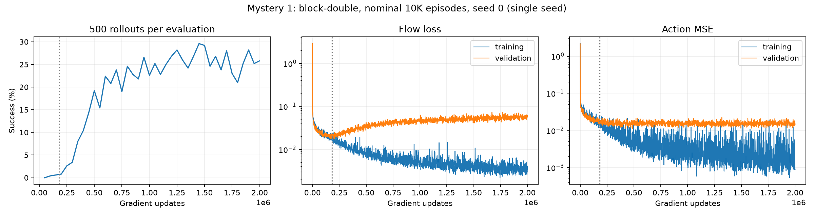

# Results

Status: first full 2M-update run completed; remaining comparisons are in progress. Findings below are preliminary and single-seed.

## Evidence and exact runs

Open the [run catalog](results/runs/README.md) for every planned condition, diagnostic, configuration, and complete portable scalar log. Run names in the table below link directly to their records. Each run page lists individual evaluations by gradient update, with links to exact JSONL lines and W&B evaluation charts when available.

The live W&B project is [yzchhr/ocbench-bc-mysteries-1-4](https://forge.coreweave.com/wandb/yzchhr/ocbench-bc-mysteries-1-4). Historical metrics and evaluations are uploaded; active runs continue to update there. The [W&B run catalog](https://forge.coreweave.com/wandb/yzchhr/ocbench-bc-mysteries-1-4/runs/ocbench-catalog-v1) links back to the exact run records. Queued runs are labeled and acquire W&B links when they start.

The completed [smoke-v3 evaluation](results/runs/smoke-v3/README.md#evaluations) verifies evaluation logging and checkpoint execution; its zero-success result is a two-update smoke test, not a reproduction result.

## Completed result: Mystery 1, block-double, nominal 10K, seed 0

The [completed run](results/runs/m1-double-n10000-s0/README.md) reached **25.8% success (129/500)** at 2M updates ([exact final evaluation](results/runs/m1-double-n10000-s0/eval.jsonl#L40)). Its last five evaluations at 1.8–2M updates averaged **25.08%**; these are correlated checkpoint evaluations, not five independent seeds. The best observed evaluation was 29.6% at 1.45M updates ([record](results/runs/m1-double-n10000-s0/eval.jsonl#L29)); choosing this maximum is optimistic and is not the final score.

Validation flow loss reached its recorded minimum of 0.017516 at 182K updates, then increased to 0.056173 at 2M (3.21×), while final training flow loss fell to 0.003367. Rollout success increased from 0.8% at the nearby 200K evaluation to 25.8% at 2M. This supports the qualitative Mystery 1 pattern that worsening validation flow loss can coexist with improving control. It does not yet establish the dataset-size reversal or robustness across seeds. Final validation action MSE was 0.014597. See the [computed analysis](results/runs/m1-double-n10000-s0/analysis.json), [complete loss log](results/runs/m1-double-n10000-s0/metrics.jsonl), and [W&B charts](https://forge.coreweave.com/wandb/yzchhr/ocbench-bc-mysteries-1-4/runs/ocb7d868146415f56201).

The nominal 10,000 training episodes retained 7,866 successful episodes (12,465,118 transitions); validation retained 97 episodes (152,756 transitions). The run took approximately 16.74 hours through the final training log, including collection and earlier evaluations. All 40 scheduled 500-episode evaluations are recorded. The latest two checkpoints (1.9M and 2M) remain local and are excluded from Git. The final checkpoint deserialized on CPU with all 117 numeric leaves finite; optimizer count is 2,000,000. Its size and SHA-256 are recorded in the analysis; this integrity check does not constitute a fresh rollout evaluation.

At the completion snapshot, Mystery 4's 500K evaluations were 27.2% handcrafted, 2.2% standardized, and 0.2% xyz×0.1. These partial single-seed results suggest a substantial feature-scaling effect, but all runs remain unfinished and xyz×10 has only just started. The queue has one completed experiment, four active, 23 pending, and no recorded failures. Existing protocol limitations above still apply.

## Shared demonstration cache and producer overlap

The [performance report](results/cache-performance/README.md) contains exact timings, W&B charts, storage/privacy checks, and parallel-generation evidence. A full-model comparison completed 8,192 updates across four independent and four shared-data consumers. Combined collection/preprocessing/training work fell from **379.04s to 186.90s (2.03×)**. Median cache reads were **0.287s** versus **63.92s** for fresh collection; a separate training-node read took **0.406s** and matched the producer's raw-data SHA-256. All shared consumers received identical arrays and finite training losses.

Four parallel A6000 prefill jobs then served 32 collection requests, generating 28 fresh collections and reusing four already in progress. Their start-to-final-finish span was **579s**, versus **1,765s** of summed fresh-generation work: **3.05× serial-work throughput**, including staggered starts. The next seed now has **36 cached collections occupying 11.89GB**; total demonstration files are **15.29GB**. The shared cache cap is **80GB**, including write reservations; four-consumer cleanup bounds retention. Data and private scheduler paths remain excluded from Git.

These measurements do not establish a 2× or 3× production learner speedup. Synchronized cache misses can still block all consumers. Future streaming workers therefore start a private, on-demand two-GPU producer pool on cache misses, generating disjoint indices ahead of four trainers. The benchmark-based ideal overlap estimate is **1.47× with one producer** or **2.95× with two**, pending sustained production measurements and resource availability. Already-running seed-0 workers remain unchanged because their old checkpoints omit exact sampler state. Model precision, batch size, collection size, and update horizons are unchanged. Twenty-five tests, the full-model benchmark, cross-node loading, and a private producer entry-point smoke test passed.

## Isolated A6000 training profile

A dedicated single-GPU Slurm profile tested eight full-model execution variants with three timing repeats each. [Exact timing records, approximate MFU, and trace aggregates](results/profiling/README.md) are available separately from the scientific runs; these are synthetic throughput tests.

The original host-fed update loop sustained **36.29 updates/s**. Device-resident inputs plus buffer donation gave **36.30/s**, explicit TF32 **36.13/s**, and eight-update compiled groups **37.16/s** (2.4% faster). BF16 reached **56.58/s** (1.56×), with finite losses but unverified task-learning equivalence. Strict FP32 precision was slower at **19.58/s**. Default-mode CUDA traces contain tensor-core GEMMs; GEMM events account for approximately 56% of recorded GPU-event durations. Thus high GPU activity does not mean all runtime is matrix multiplication.

Analytical dense-matrix FLOPs divided by the precision-specific dense peak yield approximately **39% training-loop MFU** for the default path and **31% for BF16**. These are estimates, not hardware counters: the default denominator assumes TF32 tensor-core execution, and the numerator omits elementwise, normalization, and optimizer operations. The profiler's raw XLA cost analysis omits substantial library/loop work and is explicitly rejected as an MFU numerator. Higher precision-dependent MFU does not necessarily mean faster training.

Production streaming runs spend roughly 75% of elapsed time collecting demonstrations (about 64% for the newer parallelism setting). A 1.56× update speedup therefore implies only approximately 10–15% end-to-end improvement if other costs stay unchanged. The isolated simulator sweep measured 115.28s for 1,000 episodes at parallel512 versus 63.33s at parallel1024 (1.82×); 2,500 episodes at parallel2500 took 88.08s (28.38 episodes/s), testing a larger collection rather than the current protocol. The larger simulator parallelism cap is already used by newer/future processes. Existing reproduction workers were preserved: grouped updates offer little benefit, and changing arithmetic requires learning validation. Existing checkpoints contain agent/optimizer/RNG state but omit the data-sampler cursor/permutation and streaming snapshot, so exact continuation cannot be asserted without additional resume-state support.

## Ten-experiment scope and individual-job preparation

The current scope is [four Mystery 1 and six Mystery 4 experiments](EXPERIMENTS.md),
including two new fixed XYZ Fourier feature conditions. The completed Mystery 1
run is retained. Four source Mystery 4 checkpoints are pinned locally: handcrafted,
standardized and XYZ×0.1 at **1.1M** updates, and XYZ×10 at **800K**.
[Checkpoint integrity evidence](results/validation/migration-checkpoints.json)
records hashes and finite-state checks without uploading checkpoints.

Individual continuations restore network, optimizer, agent RNG and saved input/action
transforms. They use fresh streaming data and a replacement validation set; this
boundary is explicit, and cross-boundary validation losses are not measurements on
the same held-out samples. A small-model CPU test verifies exact next-update parity
after agent-state restoration. Both Fourier input widths also passed a small-model
[update/action-sampling integration check](results/validation/fourier-integration.json).
All 28 tests pass. These checks establish preparation integrity, not resumed GPU
launch success or new reproduction results. Nine individual launches are prepared
(four continuations and five new experiments); none were submitted in this preparation.

## Planned comparisons

- Mystery 1: block-double with fixed 10,000 episodes; track training/validation flow loss, action MSE, and success over training. Repeat block-double at seed 1, then compare block-single with independently sampled 10,000 versus 50,000 episodes at training seed 0.
- Mystery 4: six block-double streaming runs at seed 0: handcrafted, standardized, XYZ scaled by 0.1 or 10, and two fixed XYZ Fourier feature extensions. See [the ten-experiment plan and exact network contract](EXPERIMENTS.md).

Reference defaults: eight 4096-wide residual MLP layers, action chunks of 25, batch size 1024, learning rate 1e-4, 10 flow steps. Blog-specific settings beyond the public reference commands remain unverified. Finite streaming runs approximate the infinite-data setting.

## Validation

- Local Python 3.11 environment installed from the pinned submodule; exact resolved versions are in `results/environment.txt`.
- Four preprocessing/metric tests pass (including zero-success serialization): xyz index mapping, constant-feature stability, and identical frozen training/evaluation transforms.
- Full reference FBC model has 136,179,887 parameters. Three synthetic GPU updates at batch size 1024 produced finite flow losses: 2.92764, 3.65450, 2.35684. This validates execution and memory capacity, not task learning.
- End-to-end GPU smoke test completed demonstration collection, two updates, four rollout evaluations, and checkpoint saving. Four full reference-model workers each reached 100 real updates with finite training and validation losses.
- Checkpoints remain local; the latest two per run are retained.

The planned dataset-size comparison uses independent generation seeds (0 for 10K, 10000 for 50K), with training seed 0 in both groups. Feature variants share generation and training seeds; GPU simulation is not bitwise deterministic, so separately generated streams can differ slightly despite paired seeds. Requested episode counts are before upstream success filtering; actual retained episodes/transitions are logged locally in each run.

<!-- LIVE_RESULTS_START -->
## Live experiment status

[W&B project](https://forge.coreweave.com/wandb/yzchhr/ocbench-bc-mysteries-1-4) · [W&B run catalog](https://forge.coreweave.com/wandb/yzchhr/ocbench-bc-mysteries-1-4/runs/ocbench-catalog-v1)

Pilot runs validate execution only. Reproduction runs target 2,000,000 updates; partial curves do not establish either mystery.

| Run records | W&B | Updates | Train flow | Val flow | Val action MSE | Success | Eval update | Finished |
| --- | --- | ---: | ---: | ---: | ---: | ---: | ---: | --- |
| [m1-double-n10000-s0](results/runs/m1-double-n10000-s0/README.md) | [Charts](https://forge.coreweave.com/wandb/yzchhr/ocbench-bc-mysteries-1-4/runs/ocb7d868146415f56201) | 2000000 | 0.0034 | 0.0562 | 0.0146 | 0.2580 | 2000000 | yes |
| [m4-handcrafted-s0](results/runs/m4-handcrafted-s0/README.md) | [Charts](https://forge.coreweave.com/wandb/yzchhr/ocbench-bc-mysteries-1-4/runs/ocb6555c1eef3e7c6a5b) | 1113000 | 0.0132 | 0.0127 | 0.0121 | 0.4740 | 1100000 | no |
| [m4-standardized-s0](results/runs/m4-standardized-s0/README.md) | [Charts](https://forge.coreweave.com/wandb/yzchhr/ocbench-bc-mysteries-1-4/runs/ocbdf09e0125b1d85354) | 1141000 | 0.0131 | 0.0119 | 0.0109 | 0.3820 | 1100000 | no |
| [m4-xyz0.1-s0](results/runs/m4-xyz0.1-s0/README.md) | [Charts](https://forge.coreweave.com/wandb/yzchhr/ocbench-bc-mysteries-1-4/runs/ocbb5e56eb1e20d223a2) | 1120000 | 0.0125 | 0.0131 | 0.0130 | 0.0180 | 1100000 | no |
| [m4-xyz10-s0](results/runs/m4-xyz10-s0/README.md) | [Charts](https://forge.coreweave.com/wandb/yzchhr/ocbench-bc-mysteries-1-4/runs/ocb8f3a301437f09df88) | 873000 | 0.0154 | 0.0169 | 0.0280 | 0.5500 | 850000 | no |
| [pilot-m1-double-n10000-s0](results/runs/pilot-m1-double-n10000-s0/README.md) | [Charts](https://forge.coreweave.com/wandb/yzchhr/ocbench-bc-mysteries-1-4/runs/ocb68488cbd9d27a930e) | 100 | 0.2445 | 0.2911 | 0.1626 | — | — | no |
| [pilot-m4-handcrafted-s0](results/runs/pilot-m4-handcrafted-s0/README.md) | [Charts](https://forge.coreweave.com/wandb/yzchhr/ocbench-bc-mysteries-1-4/runs/ocbe05d0f1b8fc3f1410) | 100 | 0.2729 | 0.3451 | 0.2120 | — | — | no |
| [pilot-m4-standardized-s0](results/runs/pilot-m4-standardized-s0/README.md) | [Charts](https://forge.coreweave.com/wandb/yzchhr/ocbench-bc-mysteries-1-4/runs/ocb6d452dd304eeae07c) | 100 | 0.3114 | 0.3221 | 0.1346 | — | — | no |
| [pilot-m4-xyz0.1-s0](results/runs/pilot-m4-xyz0.1-s0/README.md) | [Charts](https://forge.coreweave.com/wandb/yzchhr/ocbench-bc-mysteries-1-4/runs/ocbff8e42a1745ad8ec8) | 100 | 0.3143 | 0.3025 | 0.1196 | — | — | no |

Blank evaluation cells mean no recorded evaluation yet. Undefined duration aggregates at zero success are stored as null; success itself remains zero.
<!-- LIVE_RESULTS_END -->
