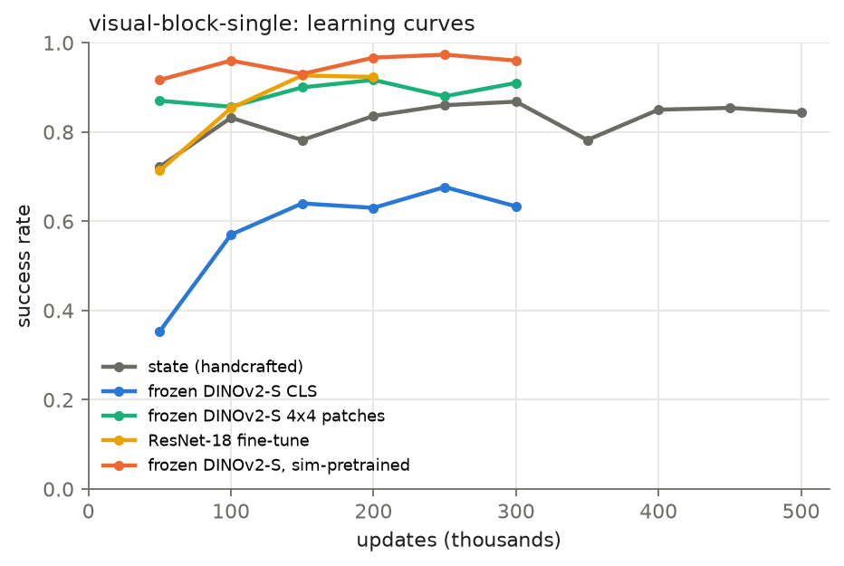
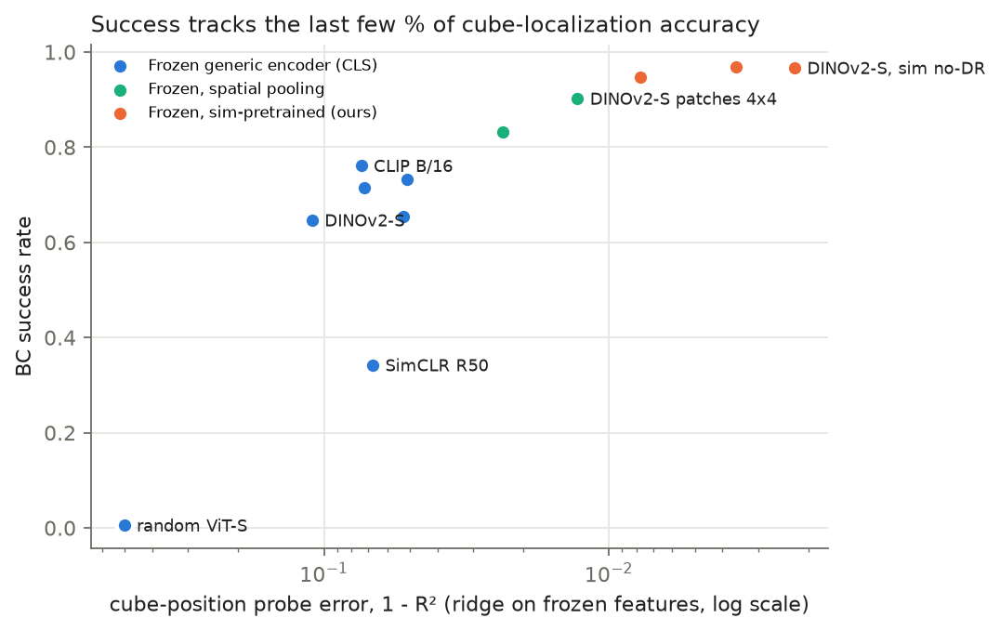
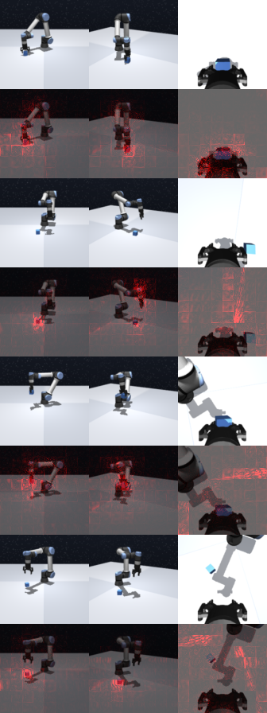
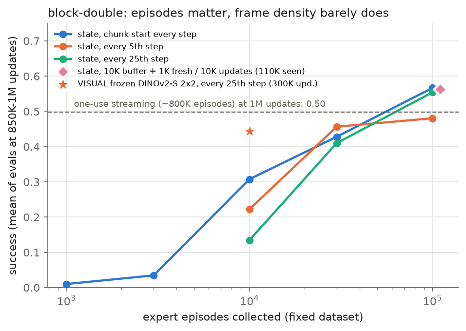
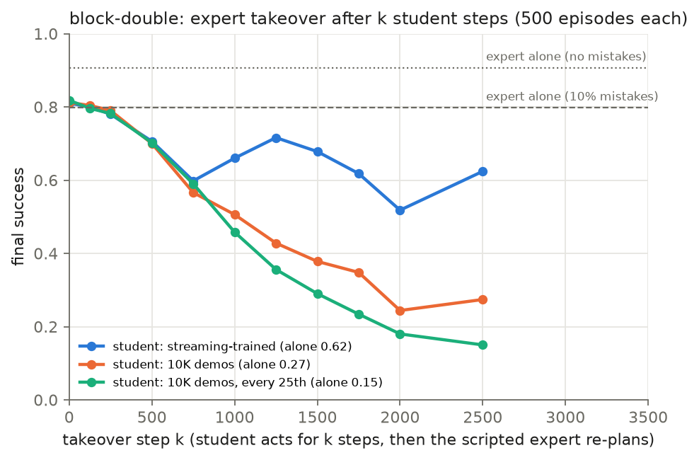

# Visual BC experiments: full setup and results

Companion to **[VISION_HIGHLIGHTS.md](VISION_HIGHLIGHTS.md)**.

- Raw logs: `runs/<run>/{config.json,metrics.jsonl,eval.jsonl}`. Checkpoints are not in git.
- Machine-readable summary: [`results/vision/summary.json`](results/vision/summary.json).
- Figures are produced by `scripts/report_vision.py`.
- W&B project `yzchhr/ocbench-bc-mysteries-1-4`, groups `m4-vision-single` (part A) and `double-data-regime`
  (part B).

## Common setup

**Environments**
- **OCBench `visual-block-single-task1-v0`**: one cube, horizon 1250. Three cameras (front, side, wrist); RGB is
  224 px, resized to 112 px for pixel policies.
- **`block-double-task1-v0` / `visual-block-double-task1-v0`**: two cubes, horizon 2500.

**Demonstrations**
- **Single**: OCBench's released visual dataset, 10K expert episodes. Images exist every 25 steps; only
  successful episodes are kept, giving 235,673 training frames.
- **Double (visual)**: the released visual-block-double dataset, also 10K episodes with images every 25 steps.
- **Double (state, data-regime study)**: freshly collected with the OCBench MJWarp scripted expert. See part B.

**Policy**
- Flow-matching BC, ported to PyTorch from OCBench FBC for the visual runs (state runs use the original JAX FBC).
- Network: residual MLP 8 × 4096 with LayerNorm. It predicts 25 × 7 action chunks.
- Flow: time ~ Beta(1, 1.5), 10 Euler steps at inference.
- Optimizer: Adam, learning rate 1e-4, batch 1024. Pixel policies use batch 256 and an encoder learning rate of
  1e-4 (DINOv2-S fine-tune: 1e-5). Pixel policies also use a DrQ random shift.
- Actions are normalized with the OCBench `ActionNormalizer` (1st/99th percentiles, clip at 5).

**Visual observation**
- All three cameras go through the same encoder; the per-camera features are concatenated.
- Frozen encoders are run once and cached as fp16 features (`data/emb/<env>/<encoder>`).
- Features are standardized per dimension unless stated otherwise.

**Evaluation**
- Batched MJWarp rollouts. The policy sees a new observation every 25 steps and executes each chunk open-loop;
  state policies also act on 25-step chunks.
- 300 episodes per evaluation for visual runs and 500 for state runs, every 50K updates.
- "Success" below is the mean of the **last three** evaluations; "best" is the maximum over all evaluations.

**Infrastructure**
- Slurm partition `deepaklong` (A6000 / A5000). Jobs requeue automatically on preemption or time limit,
  checkpoint every 5K–25K updates, and resume the same W&B run.
- Launchers: `scripts/launch_m4v.py` (part A), `scripts/launch_regime.py` (part B).

---

# Part A: visual-block-single (W&B group `m4-vision-single`)



## A. State baselines (JAX FBC, 10K demos, chunk starts every 25 steps = the visual frames, 500K updates)

| Run | Features | Success | Best |
| --- | --- | ---: | ---: |
| `v-state-single-n10000-int25-s0` | handcrafted | 0.85 | 0.87 |
| `v-state-single-standardized-n10000-int25-s0` | z-score | 0.85 | 0.89 |
| `v-state-single-xyz0.1-n10000-int25-s0` | z-score, xyz ×0.1 | 0.82 | 0.85 |
| `v-state-single-xyz10-n10000-int25-s0` | z-score, xyz ×10 | 0.87 | 0.90 |
| `v-state-single-fourier4-n10000-int25-s0` | z-score + Fourier(1,2,4,8) | 0.86 | 0.88 |

Reference: Mystery-1 single-task run with all chunk starts and 2M updates, 89.2% ([RESULTS.md](RESULTS.md)).

## B. Frozen pretrained encoders (CLS / global feature, 300K updates)

| Run | Encoder | Feature dim × 3 cams | Success | Best |
| --- | --- | --- | ---: | ---: |
| `v-B-random_vit_s-s0` | ViT-S/16, random init | 384 | 0.01 | 0.01 |
| `v-B-simclr_r50-s0` | ResNet-50 SimCLR | 2048 | 0.34 | 0.37 |
| `v-B-dinov2_s-s0` | DINOv2 ViT-S/14 | 384 | 0.65 | 0.68 |
| `v-B-resnet50_ce-s0` | ResNet-50 ImageNet classification | 2048 | 0.65 | 0.67 |
| `v-B-dinov2_b-s0` | DINOv2 ViT-B/14 | 768 | 0.71 | 0.75 |
| `v-B-mae_b16-s0` | MAE ViT-B/16 | 768 | 0.73 | 0.76 |
| `v-B-clip_b16-s0` | CLIP ViT-B/16 | 512 | 0.76 | 0.79 |

## C. Embedding scale and spatial readout

| Run | Variant | Success | Best |
| --- | --- | ---: | ---: |
| `v-C-dinov2_b-raw-s0` | DINOv2-B, raw features | 0.69 | 0.71 |
| `v-B-dinov2_b-s0` | DINOv2-B, standardized | 0.71 | 0.75 |
| `v-C-dinov2_b-x0.1-s0` | DINOv2-B, standardized ×0.1 | 0.75 | 0.77 |
| `v-C-dinov2_b-x10-s0` | DINOv2-B, standardized ×10 | 0.78 | 0.80 |
| `v-C-dinov2_s_p2-s0` | DINOv2-S, patch tokens average-pooled 2×2 | 0.83 | 0.88 |
| `v-C-dinov2_s_p4-s0` | DINOv2-S, patch tokens average-pooled 4×4 | **0.90** | 0.92 |

## D. End-to-end visual encoders (pixels at 112 px, batch 256, 200K updates)

| Run | Encoder | Success | Best |
| --- | --- | ---: | ---: |
| `v-D-impala-scratch-s0` | Impala CNN from scratch | 0.86 | 0.89 |
| `v-D-resnet18-ft-s0` | ResNet-18 ImageNet, fine-tuned | 0.90 | 0.93 |
| `v-D-dinov2_s-ft-s0` | DINOv2-S, fine-tuned at encoder learning rate 1e-5 | 0.88 | 0.95 |

## E. Auxiliary state regression (predict qpos from the observation features, labelled fraction of episodes)

| Run | Base | Aux fraction | Success | Best |
| --- | --- | ---: | ---: | ---: |
| `v-E-dinov2_b-adapter-aux0-s0` | frozen DINOv2-B + trainable adapter | 0 | 0.60 | 0.64 |
| `v-E-dinov2_b-adapter-aux0.01-s0` | 〃 | 1% | 0.58 | 0.58 |
| `v-E-dinov2_b-adapter-aux0.1-s0` | 〃 | 10% | 0.61 | 0.62 |
| `v-E-dinov2_b-adapter-aux1-s0` | 〃 | 100% | 0.61 | 0.62 |
| `v-D-impala-scratch-s0` | Impala end-to-end | 0 | 0.86 | 0.89 |
| `v-E-impala-aux0.01-s0` | 〃 | 1% | 0.82 | 0.91 |
| `v-E-impala-aux0.1-s0` | 〃 | 10% | 0.69 | 0.78 |
| `v-E-impala-aux1-s0` | 〃 | 100% | 0.70 | 0.77 |

## F. Encoder pretraining on simulated (image, state) pairs, then frozen BC

**Data** (`scripts/dr_gen.py`, 200K states, about 6 min on 30 CPU workers):
- States are sampled from the demonstration qpos.
- In 50% of samples the cube is re-placed uniformly over the demo xy range with a random yaw.
- Arm joints get N(0, 0.05 rad) noise, and the gripper opening is uniform.
- Each state is rendered twice:
  - `nodr`: nominal appearance;
  - `dr`: random geom/material colors, light/headlight changes, camera position ±2 cm (wrist ±0.5 cm) and
    orientation ±3° (wrist ±1.5°).

**Targets** (27-d, standardized):
- cube position in each camera frame (9);
- cube position in the gripper/pinch frame (3);
- sin/cos of 4 × cube yaw (2);
- pinch xyz (3), gripper opening (1), arm joints (6), cube world xyz (3).

**Pretraining** (`scripts/pretrain_enc.py`): timm backbone shared across the 3 cameras + MLP head. AdamW, head
learning rate 3e-4, backbone 5e-5, cosine schedule, 40K steps, batch 128. The last 5% of samples are held out.

| Encoder run | Init | Data | Held-out R²: cube-in-camera / cube-in-gripper / yaw / pinch / arm | BC run | Success | Best |
| --- | --- | --- | --- | --- | ---: | ---: |
| `v-F-enc-nodr-dinov2s` | DINOv2-S | nodr | 0.926 / 0.998 / 0.987 / 0.999 / 0.848 | `v-F-bc-enc-nodr-dinov2s-s0` | **0.97** | 0.97 |
| `v-F-enc-dr-dinov2s` | DINOv2-S | dr | 0.988 / 0.980 / 0.963 / 0.997 / 0.840 | `v-F-bc-enc-dr-dinov2s-s0` | **0.97** | 0.97 |
| `v-F-enc-dr-resnet18` | scratch | dr | 0.978 / 0.966 / 0.907 / 0.995 / 0.847 | `v-F-bc-enc-dr-resnet18-s0` | 0.95 | 0.96 |

## Linear probes (ridge, frozen features → demo state), `scripts/embed_probe.py`

| Encoder | Mean R² (arm, gripper, cube) | Cube xyz R² | BC success |
| --- | ---: | ---: | ---: |
| random ViT-S | 0.479 | 0.497 | 0.01 |
| SimCLR R50 | 0.873 | 0.933 | 0.34 |
| DINOv2-S | 0.851 | 0.890 | 0.65 |
| ResNet-50 | 0.879 | 0.947 | 0.65 |
| DINOv2-B | 0.880 | 0.928 | 0.71 |
| MAE ViT-B | 0.906 | 0.949 | 0.73 |
| CLIP B/16 | 0.853 | 0.926 | 0.76 |
| DINOv2-S 2×2 | 0.909 | 0.976 | 0.83 |
| DINOv2-S 4×4 | 0.937 | 0.987 | 0.90 |
| sim-pretrained ResNet-18 (DR) | 0.931 | 0.992 | 0.95 |
| sim-pretrained DINOv2-S (DR) | 0.942 | 0.996 | 0.97 |
| sim-pretrained DINOv2-S (no DR) | 0.945 | 0.998 | 0.97 |



## Saliency

`scripts/saliency.py` computes |∂‖a‖²/∂pixel| on 256 held-out frames with fixed flow noise.

`cube_ratio` = mean saliency on (dilated) cube pixels ÷ mean saliency over the image. A value of 1 means no cube
preference. For pooled-patch policies the ratio is less meaningful, because their features are spatial averages.

| Run | front | side | wrist |
| --- | ---: | ---: | ---: |
| `v-F-bc-enc-nodr-dinov2s-s0` | **5.69** | **5.81** | 2.34 |
| `v-D-dinov2_s-ft-s0` | 4.43 | 4.63 | 2.81 |
| `v-D-impala-scratch-s0` | 2.38 | 2.45 | 3.92 |
| `v-F-bc-enc-dr-dinov2s-s0` | 1.99 | 2.39 | 2.05 |
| `v-D-resnet18-ft-s0` | 1.47 | 1.55 | 1.79 |
| `v-B-dinov2_b-s0` | 1.25 | 1.31 | 0.84 |
| `v-B-clip_b16-s0` | 1.25 | 1.08 | 1.08 |
| `v-B-simclr_r50-s0` | 0.37 | 0.46 | 0.46 |
| `v-C-dinov2_s_p4-s0` | 0.39 | 0.36 | 0.56 |

Example frames (rows: image, saliency overlay) for the sim-pretrained policy:



All saliency JSON/PNG files are in `results/diagnostics/saliency/`.

---

# Part B: block-double (W&B group `double-data-regime`)

## B1. Data-regime study (state FBC, JAX, handcrafted features, 1M updates)

**Data**: `scripts/collections_store.py` stores 1K-episode collections from the OCBench MJWarp scripted expert,
using the same seeding as the streaming pipeline. Only successful episodes are kept, together with qpos for later
re-rendering. The scripted expert succeeds on 78.9% of collected episodes; a successful episode is 1584 steps on
average.

**Trainer**: `scripts/train_regime.py`.
- A fixed-N run uses collections 0..N/1K−1.
- *start interval k*: chunk starts only at episode steps 0, k, 2k, … (k = 25 matches visual frame availability).
- *replay*: a FIFO buffer of N episodes that receives 1K fresh episodes (collections 1000+) every R updates.



| Run | Buffer episodes | Start interval | Refresh every | Episodes seen | Chunk starts | Success 450–600K | Success 850K–1M |
| --- | ---: | ---: | ---: | ---: | ---: | ---: | ---: |
| `r-fixed-n1k` | 1K | 1 | – | 1K | 1.27M | 0.01 | 0.01 |
| `r-fixed-n3k` | 3K | 1 | – | 3K | 3.7M | 0.03 | 0.03 |
| `r-fixed-n10k` | 10K | 1 | – | 10K | 12.5M | 0.25 | 0.31 |
| `r-fixed-n10k-int5` | 10K | 5 | – | 10K | 2.5M | 0.18 | 0.22 |
| `v-state-double-n10000-int25-s0` | 10K | 25 | – | 10K | 0.7M | 0.13 | 0.13 |
| `r-fixed-n30k` | 30K | 1 | – | 30K | 37.4M | 0.24 | 0.43 |
| `r-fixed-n30k-int5` | 30K | 5 | – | 30K | 7.5M | 0.23 | 0.46 |
| `r-fixed-n30k-int25` | 30K | 25 | – | 30K | 1.5M | 0.27 | 0.41 |
| `r-fixed-n100k` | 100K | 1 | – | 100K | 125M | 0.31 | **0.57** |
| `r-fixed-n100k-int5` | 100K | 5 | – | 100K | 25M | 0.23 | 0.48 |
| `r-fixed-n100k-int25` | 100K | 25 | – | 100K | 5.0M | 0.41 | **0.55** |
| `r-replay-b10k-r10k` | 10K | 1 | 10K | 110K | 12.5M | 0.34 | **0.56** |
| `r-replay-b10k-r2k` | 10K | 1 | 2K | 510K (planned) | 12.4M | 0.39 | *running* |
| `r-replay-b30k-r5k-int25` | 30K | 25 | 5K | 230K (planned) | 1.5M | 0.33 | *running* (0.48 at 750–900K) |
| `m4-handcrafted-s0` (Mystery 4) | one-use streaming | 1 | each start used once | ~800K at 1M | – | 0.27 | 0.50 |
| `m1-double-n10000-s0` (Mystery 1) | 10K (`train.py` data) | 1 | – | 10K | 17.8M | 0.18 | 0.23 |

Notes:
- 10K runs overfit: final validation flow loss is 0.09–0.12 at ≤10K episodes vs 0.016 at 100K.
- `v-state-double-n10000-int25-s0` and `m1-double-*` use the older `train.py` dataset (`data/block-double-task1-v0-n10000-d0`),
  not the collection store.

## B2. Expert-alone and takeover diagnostics (`scripts/takeover.py`)

Setup:
- The same initial states are used for every k (evaluation seeding).
- The student acts for k steps with open-loop 25-step chunks, then `BlockMjWarpController` re-plans from the
  current simulator state and acts until the 2500-step horizon.
- The expert's deliberate-mistake probability is configurable via `OCB_MISTAKE_PROB`. This is a local edit in the
  `ocbench` submodule; see `patches/ocbench-mistake-prob.patch`. The default (0.1) is unchanged.

| Expert alone (1000 episodes) | Success |
| --- | ---: |
| default (10% deliberate mistakes per planned move) | 0.798 |
| mistakes disabled | 0.907 |



Final success when the expert takes over at step k (500 episodes per entry). The parenthesis is the rescue rate:
success among episodes still unsolved and alive at k.

| k | `m4-handcrafted-s0-cont2` (alone 0.62) | `m1-double-n10000-s0` (alone 0.27) | `v-state-double-n10000-int25-s0` (alone 0.15) |
| ---: | --- | --- | --- |
| 0 | 0.81 | 0.81 | 0.82 |
| 250 | 0.78 | 0.79 | 0.78 |
| 500 | 0.71 | 0.70 | 0.70 |
| 750 | 0.60 | 0.57 | 0.59 |
| 1000 | 0.66 (0.66) | 0.51 (0.50) | 0.46 (0.46) |
| 1250 | **0.72** (0.71) | 0.43 (0.42) | 0.36 (0.35) |
| 1500 | 0.68 (0.65) | 0.38 (0.35) | 0.29 (0.27) |
| 1750 | 0.62 (0.52) | 0.35 (0.27) | 0.23 (0.20) |
| 2000 | 0.52 (0.27) | 0.24 (0.12) | 0.18 (0.11) |
| 2500 | 0.62 | 0.27 | 0.15 |

The decline at large k mixes "state is unrecoverable" with "not enough time left for the expert's plan". A
follow-up with an extended expert horizon would separate the two.

## B3. Visual policies on visual-block-double and transfer runs (frozen embeddings, 300K updates)

Data: the released visual-block-double dataset (10K episodes, images every 25 steps). `vis_prep.py --no-images`
builds the index only, so frozen-embedding runs do not need the 83 GB 112-px image cache.

| Run | Encoder | Success | Best | Status |
| --- | --- | ---: | ---: | --- |
| `v-state-double-n10000-int25-s0` | state, same data regime | 0.14 | 0.17 | done (1M updates) |
| `v-dbl-dinov2_s-s0` | DINOv2-S CLS | 0.25 | 0.26 | done |
| `v-dbl-dinov2_s_p2-s0` | DINOv2-S 2×2 patches | **0.44** | 0.47 | done |

<a id="d3-transfer-runs"></a>Transfer runs submitted 2026-11-13. Each tests whether a single-task finding holds on
double; all use `scripts/launch_regime.py --only X`.

| Run | Single-task finding tested |
| --- | --- |
| `v-dbl-dinov2_b-s0`, `v-dbl-clip_b16-s0`, `v-dbl-resnet50_ce-s0`, `v-dbl-random_vit_s-s0` | encoder ranking (CLS) |
| `v-dbl-dinov2_s_p4-s0` | 4×4 patch pooling |
| `v-dbl-F-enc-nodr-dinov2s` → `v-dbl-F-bc-enc-nodr-dinov2s-s0` | sim-pretrained encoder. `dr_gen.py` now supports N cubes: 2 × 17 per-cube targets + 10 robot targets = 44-d |

## B4. Compute and storage cost of going visual (measured, `scripts/bench_vis_cost.py`)

| Item | Measured |
| --- | --- |
| Expert state collection (MJWarp, 1000 parallel worlds) | 67 s per 1K episodes |
| Collection with OCBench in-loop rendering (3 cams, 224 px), image every 25 steps | 391 s per 1K episodes (state-only at the same batch size: 231 s) |
| 〃, image every 5 steps | 1120 s per 1K episodes |
| Offline re-render from stored qpos (EGL, GPU) | ~456 states/s per process; ~1.1K states/s per GPU with 30 processes |
| Frozen DINOv2-S embedding, 3 cams at 112 px (A5000) | ~1090 frames/s (CLS and patch pooling alike) |
| Training, 1M updates | state 31.8 updates/s (8.7 h); frozen CLS 25/s (11 h); frozen 2×2 patches 20.5/s (13.6 h) |

Per 1K collected episodes:
- 789 successful episodes, 1.25M transitions;
- images every 25 steps → 50K frames; every 5 steps → 250K frames; every step → 1.25M frames.

Storage per frame (3 cameras):

| Format | Bytes per frame | Per 1K episodes, every 25 steps | Per 100K episodes, every 25 steps |
| --- | ---: | ---: | ---: |
| uint8 112 px | 113 KB | 5.7 GB | 565 GB |
| uint8 224 px | 452 KB | 23 GB | 2.3 TB |
| fp16 CLS (384-d) | 2.3 KB | 0.12 GB | 11.6 GB |
| fp16 2×2 patches | 9.2 KB | 0.46 GB | 46 GB |
| fp16 4×4 patches | 37 KB | 1.85 GB | 185 GB |

Implications:
- Frozen-embedding visual BC at the "100K episodes, every 25 steps" regime (state success 0.55) costs about
  4.6 GPU-h of data preparation (collect 1.9 + render 1.4 + embed 1.3) plus 11–14 GPU-h of training.
- One-use streaming with rendering (M4-style, about 1B rendered samples per 1M updates) would cost about
  550 GPU-h: not viable.
- A rolling buffer (10K episodes, refreshed every 10K updates) keeps storage at about 5 GB and adds about 20% to
  training time.
- End-to-end pixel training needs the raw-image cache: about 57 GB for 10K episodes at 112 px.

---

## Reproduce

```bash
source scripts/env.sh
python scripts/launch_m4v.py --list          # part A matrix (34 jobs)
python scripts/launch_regime.py --list       # part B (prefill P, regime R, takeover T, bench B, visual V, transfer X)
.venv/bin/python scripts/report_vision.py    # figures + results/vision/summary.json
```

| Script | Purpose |
| --- | --- |
| `vis_common.py`, `vis_prep.py`, `embed_probe.py`, `train_vis.py` | visual data index, embedding cache, probes, visual flow-BC trainer |
| `dr_gen.py`, `pretrain_enc.py` | simulated (image, state) data and encoder pretraining |
| `saliency.py` | gradient saliency |
| `collections_store.py`, `train_regime.py` | block-double expert collections and data-regime trainer |
| `takeover.py`, `bench_vis_cost.py` | expert takeover diagnostic and vision cost benchmark |
| `wandb_follow.py` | mirrors JSONL logs to W&B with resume |
| `launch_m4v.py`, `launch_regime.py` | requeue-safe Slurm launchers |
