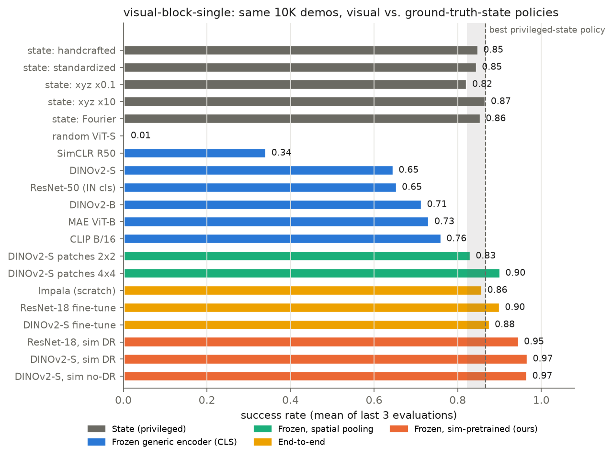
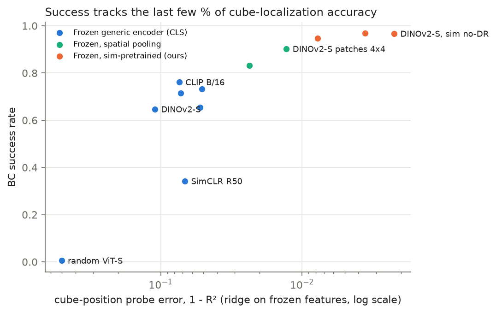
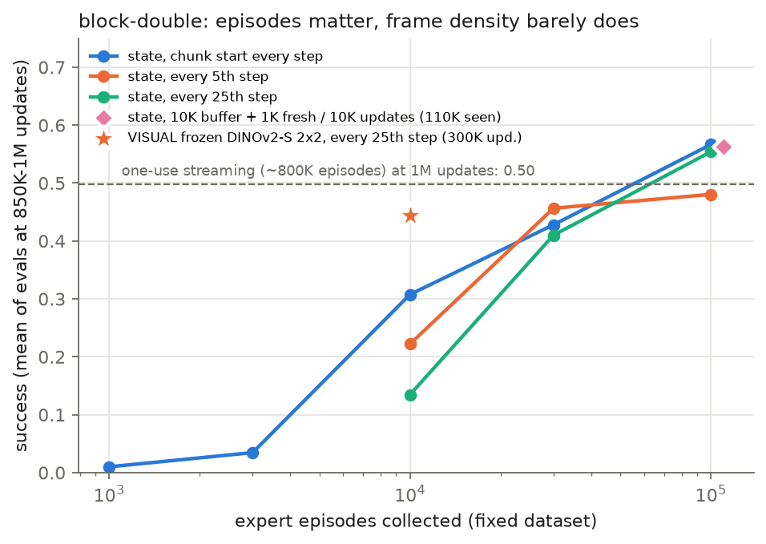
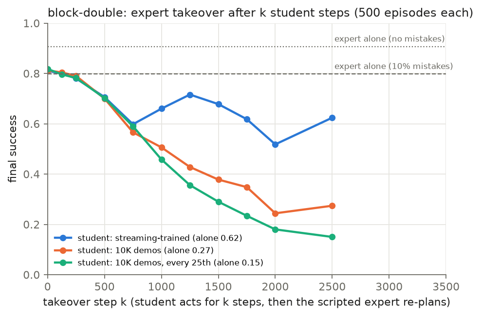
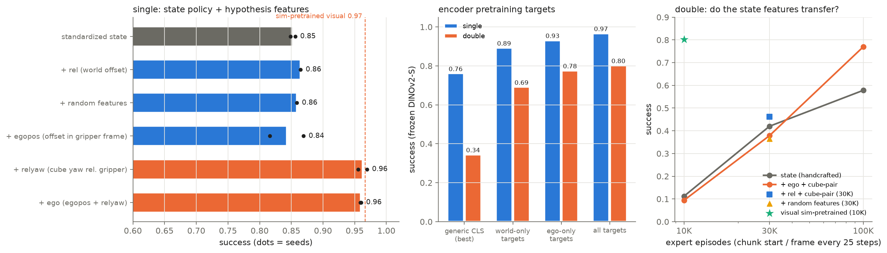

# Visual behavioral cloning on OCBench: highlights

Main scientific findings from the visual flow-BC study on `visual-block-single` (follow-up to Mystery 4 of
[Behavioral cloning mystery](https://seohong.me/blog/behavioral-cloning-mystery/)) and a first transfer study on
`block-double`. Full setup, every run, and every table: **[VISION_EXPERIMENTS.md](VISION_EXPERIMENTS.md)**.

> All numbers are single-seed. Success is the mean of the last three evaluations (300 rollouts per evaluation for
> visual policies, 500 for state policies). Neighboring checkpoints differ by about ±0.05, so gaps smaller than
> that are not claims.

## 1. A frozen encoder pretrained only on simulated (image, state) pairs beats the privileged-state policy

All policies use the **same 10K demonstrations** and the same flow-matching BC head: an 8×4096 residual MLP
predicting 25-step action chunks.

| Policy input | Success |
| --- | ---: |
| Ground-truth state: 5 featurizations (handcrafted, standardized, xyz ×0.1, xyz ×10, Fourier) | 0.82 – 0.87 |
| Frozen generic encoders (DINOv2, CLIP, MAE, ResNet-50), CLS token | 0.65 – 0.76 |
| End-to-end (Impala from scratch, ResNet-18 / DINOv2-S fine-tuned) | 0.86 – 0.90 |
| **Frozen DINOv2-S, pretrained 40K steps to regress sim state from rendered images** | **0.97** |

How the sim-pretrained encoder was built:
- The training images are **200K freshly rendered simulator states**, not extra demonstrations. They are demo
  states plus perturbations: the cube re-placed uniformly in half of them, joint noise, and random gripper opening.
- The encoder regresses task-relevant targets: cube position in each camera frame, cube position in the gripper
  frame, cube yaw, pinch position, gripper opening and arm joints.
- After pretraining, the encoder is frozen and BC runs on the original demonstrations.

Ablations:
- **Domain randomization made no difference** (0.97 with and without). A ResNet-18 trained from scratch the same
  way reaches 0.95.
- The best state policy (0.87) is still below this visual policy. That holds even with 4× the state chunk starts
  and 2M updates: Mystery 1 state run on single, 10K demos, all chunk starts, 0.89.
- **Interpretation:** the simulator's free state labels turn images into a better observation than the raw state
  vector. The encoder learns *egocentric* quantities (cube relative to gripper and cameras) that a world-frame state
  vector only provides implicitly.

## 2. Spatial pooling of frozen patch tokens: 0.65 → 0.90 with zero extra training

Same frozen DINOv2-S, only the readout changes:
- CLS token: 0.65;
- 2×2 average-pooled patch tokens: 0.83;
- **4×4 average-pooled patch tokens: 0.90.**

The 4×4 readout matches end-to-end fine-tuning (ResNet-18 fine-tune 0.90). The CLS token discards exactly what
grasping needs: *where* the cube is.

## 3. The last few percent of cube-localization accuracy decide the success rate

A ridge probe from frozen features to the cube position, 1 − R² on a log scale, orders the encoders almost
perfectly:

| Encoder | Cube-position R² | BC success |
| --- | ---: | ---: |
| Random ViT | 0.50 | 0.01 |
| Generic CLS encoders | 0.89 – 0.95 | 0.65 – 0.76 |
| Patch pooling | 0.976 / 0.987 | 0.83 / 0.90 |
| Sim-pretrained encoders | 0.992 – 0.998 | 0.95 – 0.97 |

Moving R² from 0.93 to 0.99 sounds small, but it moves success by about 0.25. One clear outlier: **SimCLR has a
normal probe R² (0.93) but only 0.34 BC success**, so a linear probe is necessary but not sufficient.

Gradient saliency (see [VISION_EXPERIMENTS.md](VISION_EXPERIMENTS.md#saliency)) agrees with this:
- The sim-pretrained policy puts **5.7×** the image-average saliency on cube pixels in the front and side cameras.
- Fine-tuned DINOv2-S puts 4.4× on cube pixels.
- Frozen generic CLS policies stay near 1.0–1.3×, i.e. barely cube-focused.

## 4. block-double: every single-task visual finding transfers, and the gaps get larger

Visual vs. state on the **same released visual-block-double data**: 10K demos, with an image (and, for the state
runs, a chunk start) only every 25 steps.

| Policy (visual runs: frozen encoder, 300K updates; state runs: 1M updates) | single | double |
| --- | ---: | ---: |
| State, same data regime | 0.85 | 0.14 |
| Random ViT-S | 0.01 | 0.00 |
| ResNet-50 / DINOv2-S / DINOv2-B / CLIP (CLS) | 0.65 / 0.65 / 0.71 / 0.76 | 0.16 / 0.25 / 0.32 / 0.34 |
| DINOv2-S, 2×2 patches | 0.83 | 0.44 |
| DINOv2-S, 4×4 patches | 0.90 | **0.70** |
| **DINOv2-S, sim-pretrained** | **0.97** | **0.80** |

On block-double:
- A frozen, sim-pretrained visual policy trained on **10K demos with sparse frames reaches 0.80**. That equals the
  scripted expert itself (0.798).
- It beats every state policy we trained, including 100K demos (0.58), a replay buffer that saw 510K episodes
  (0.59), and Mystery-4 streaming (about 0.6 at 2M updates).
- The encoder ranking is preserved.
- Patch pooling matters even more than on single: CLS 0.25 → 4×4 0.70.

## 5. block-double data regime: count episodes, not frames

State policies, 1M updates, mean success over the evaluations at 850K–1M updates:

| Expert episodes | 1K | 3K | 10K | 30K | 100K |
| --- | ---: | ---: | ---: | ---: | ---: |
| every step is a chunk start | 0.01 | 0.03 | 0.31 | 0.43 | **0.57** |
| every 5th step | | | 0.22 | 0.46 | 0.48 |
| every 25th step | | | 0.14 | 0.41 | **0.55** |

- **About 30K episodes are needed for ≥ 0.4.** 100K fixed episodes match one-use streaming (0.50 at 1M updates,
  with about 800K episodes consumed).
- **Above 30K episodes, keeping only every 25th frame costs nothing.** A visual policy only needs 1/25 of the
  frames rendered, a 25× saving in rendering and storage.
- **A small buffer of 10K episodes, refreshed with 1K fresh episodes every 10K updates (110K seen), reaches 0.56.**
  That equals 100K stored episodes at a tenth of the storage.

## 6. Expert takeover: student states stay recoverable for a long time

- The OCBench scripted expert itself solves block-double in 79.8% of episodes, or 90.7% with its deliberate 10%
  mistakes disabled. It is not a 100% oracle.
- If the best student (0.62 alone) hands over to the expert after 1000–1500 steps, final success rises to
  **0.66–0.72**.
- After 1000 student steps the expert rescues 46–66% of still-unsolved episodes, depending on the student. Most
  student-visited states are recoverable, which makes DAgger-style expert relabeling viable.
- Late takeover (≥ 2000 of 2500 steps) hurts, because the expert's replan does not fit in the remaining time.

## 7. Why does vision beat privileged state? On single: the cube yaw relative to the gripper

**Hypothesis.** The sim-pretrained encoder regressed egocentric quantities (cube relative to gripper and cameras).
A world-frame state vector only implies these.

**Test 1: hand the candidate quantities to the state policy.** Setting: block-single, 10K demos, every 25 steps,
500K updates; mean over 2 seeds where two are listed.

| State input | Success |
| --- | ---: |
| standardized state | 0.85 (0.856 / 0.849) |
| + cube − gripper offset, world frame (linear) | 0.86 |
| + random nonlinear features, same width (control) | 0.86 |
| + offset rotated into the gripper yaw frame (`egopos`) | 0.84 (0.816 / 0.869) |
| + **cube yaw relative to gripper yaw, as sin/cos(4Δψ)** (`relyaw`) | **0.96 (0.955 / 0.969)** |
| + both (`ego`) | 0.96 (0.960 / 0.959) |
| sim-pretrained visual policy | 0.97 |

On single the **entire visual–state gap is explained by one quantity: the cube's yaw relative to the gripper, folded
by the cube's 90° symmetry.**
- The raw state contains cube yaw and gripper yaw separately. The policy has to compute their difference modulo 90°,
  a discontinuous function that the MLP does not learn precisely from 10K demos.
- Positional egocentric features, linear offsets and random extra features do nothing.

**Test 2: control what the encoder is pretrained on** (then freeze it and run BC):

| Encoder targets | single | double |
| --- | ---: | ---: |
| generic CLS encoder (best: CLIP) | 0.76 | 0.34 |
| world-frame only (cube xyz, pinch xyz, gripper, arm joints) | 0.89 | 0.69 |
| egocentric only (cube in camera frames, cube in gripper frame, relative yaw) | 0.93 | 0.78 |
| all targets | 0.97 | 0.80 |

- Any sim-state supervision gives most of the jump over generic encoders, from much more precise localization.
- Egocentric targets add +0.04 (single) and +0.09 (double) on top.
- The ordering is identical on both tasks.

**On block-double the state-side explanation only partly transfers.** Setting: handcrafted base, every 25 steps,
1M updates.

| Demos | state | + ego + cube-pair offset | + rel + cube-pair | + random features |
| ---: | ---: | ---: | ---: | ---: |
| 10K | 0.11 | 0.09 | | |
| 30K | 0.42 | 0.38 | 0.46 | 0.36 |
| 100K | 0.58 | **0.77** | | |

- With enough data (100K), egocentric features add +0.19, which brings state close to the visual policy.
- At 10K–30K they do not help. There, the visual policy (0.80 from 10K) must be winning through something else that
  comes with a sim-pretrained visual representation. The world-target encoder alone already reaches 0.69, against
  0.11 for state.
- Candidate explanations to test next: robustness or smoothness from pretraining on 200K perturbed states, and
  implicit regularization by the high-dimensional frozen features.
- Note that the z-scored state base collapses on double with fixed data (30K: 0.10 vs handcrafted 0.42), so these
  tests use the handcrafted base.

## Negative results (also useful)

- **Rescaling frozen embeddings has only a small, monotone effect** on visual-block-single: raw / standardized /
  ×0.1 / ×10 → 0.69 / 0.71 / 0.75 / 0.78. There is no Mystery-4-style collapse at the embedding level.
- **Rescaling state also has no effect on single with 10K demos** (0.82–0.87). The ×0.1 collapse (0.06) only
  appears on block-double with streaming data.
- **An auxiliary state-regression loss does not help.** Frozen DINOv2-B with adapter: no aux loss 0.60 vs 1% / 10%
  / 100% labelled episodes 0.58 / 0.61 / 0.61. Impala end-to-end: no aux loss 0.86 vs 0.82 / 0.69 / 0.70.
- **Domain randomization in encoder pretraining does not matter here** (0.97 vs 0.97), because evaluation uses the
  nominal appearance.
