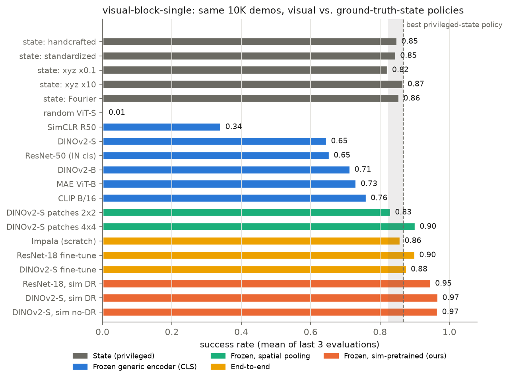
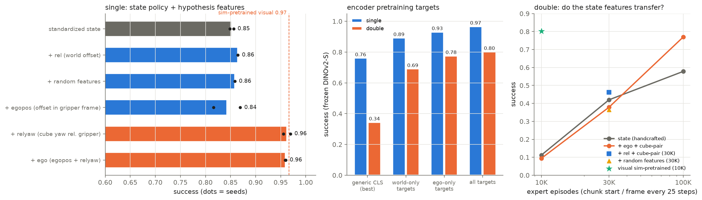
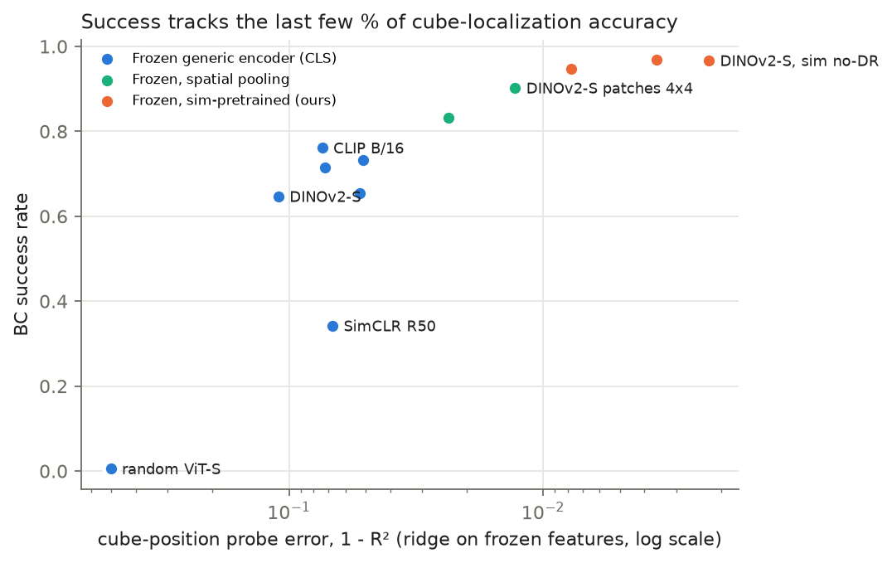
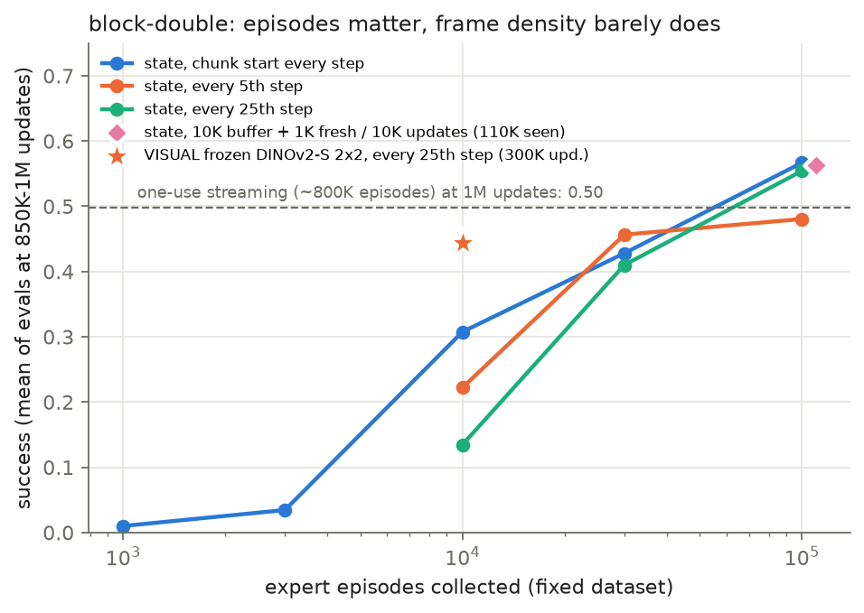
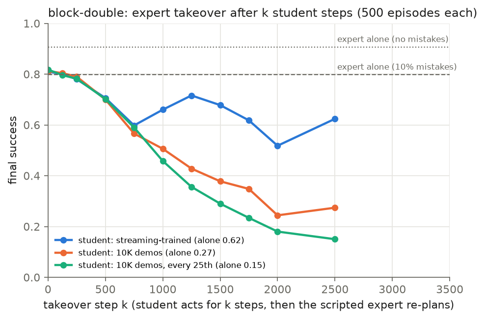

# Visual behavioral cloning on OCBench block tasks

A follow-up to Mystery 4 of [Behavioral cloning mystery](https://seohong.me/blog/behavioral-cloning-mystery/): what
happens when the flow-matching BC policy sees **images** instead of ground-truth state, on OCBench `block-single`
and `block-double`? Why does it sometimes win? How much data and compute does vision need?

**Start here.** This page has the main results. Details are split as follows:

| Document | Contents |
| --- | --- |
| [single.md](single.md) | Part A, visual-block-single: every encoder / readout / fine-tuning / sim-pretraining run, probes, saliency |
| [double.md](double.md) | Part B, block-double: data-regime study, expert takeover, visual transfer runs, compute and storage cost |
| [explanation.md](explanation.md) | Part C: experiments that test *why* vision beats state |
| [appendix.md](appendix.md) | Exact settings: compute per run, data pipelines (fixed / replay / streaming), feature definitions, encoder recipes (data, loss, lr, schedule), evaluation, and the full run index |
| [runs.csv](runs.csv), [configs/](configs/) | One row per run (settings, updates, passes, GPU-h, success) and every run's full `config.json` |
| [figures/](figures/) | All plots and `summary.json` |

All policies share the same flow-matching BC head (an 8 × 4096 residual MLP predicting 25-step action chunks) and
are trained on **10K expert demonstrations** unless stated otherwise. Success is the mean of the last three
evaluations (300 rollouts for visual policies, 500 for state). Evaluations fluctuate by about ±0.05; most runs are
single-seed, and two-seed results are marked.

---

## 1. A frozen encoder pretrained on simulated (image, state) pairs beats the privileged-state policy, by a lot on block-double

| Policy (same 10K demos; images and chunk starts every 25 steps) | block-single | block-double |
| --- | ---: | ---: |
| Ground-truth state | 0.85 | 0.14 |
| Frozen generic encoder, CLS (best: CLIP B/16) | 0.76 | 0.34 |
| Frozen DINOv2-S, 4×4 patch pooling | 0.90 | 0.70 |
| End-to-end fine-tuned ResNet-18 (single only) | 0.90 | – |
| **Frozen DINOv2-S, pretrained to regress sim state from rendered images** | **0.97** | **0.80** |

The sim-pretrained encoder:
- Is trained for 40K steps on 200K **rendered simulator states**, not on more demonstrations: demo states plus
  perturbations, regressing cube/gripper/arm targets. It is then frozen.
- Takes 1.4 GPU-hours to pretrain. Recipe: [appendix A7](appendix.md#a7-visual-encoder-recipes).

On block-double, this visual policy trained on **10K demos with an image only every 25 steps reaches 0.80, the same
as the scripted expert that produced the demos (0.798)**. It beats every state policy we trained:

| State policy | Success |
| --- | ---: |
| 100K demos | 0.58 |
| replay buffer that saw 510K episodes | 0.59 |
| one-use streaming of about 800K episodes | 0.50 at 1M updates (0.54–0.57 at 2M) |

## 2. On block-single the whole visual–state gap comes from one quantity: cube yaw relative to the gripper

The sim-pretrained encoder learned egocentric quantities. We gave candidate quantities directly to the **state**
policy (block-single, 10K demos, two seeds each where listed):

| Extra state input | Success |
| --- | ---: |
| none (z-scored state) | 0.85 (0.856 / 0.849) |
| cube − gripper offset, world frame | 0.86 |
| random nonlinear features, same width (control) | 0.86 |
| offset rotated into the gripper's yaw frame | 0.84 (0.816 / 0.869) |
| **sin/cos(4·(cube yaw − gripper yaw))** | **0.96 (0.955 / 0.969)** |
| sim-pretrained visual policy, for reference | 0.97 |

- The state vector contains both yaws, but the policy must compute their difference **modulo the cube's 90°
  symmetry**. That function is discontinuous, and the MLP does not learn it precisely from 10K demos.
- Supplying this single 2-d feature closes the entire gap. Positional egocentric features, linear offsets and extra
  random features do nothing.
- From the encoder side, pretraining on egocentric targets only beats world-frame targets only (0.93 vs 0.89 on
  single, 0.78 vs 0.69 on double). All targets together is best.

**Caveat (block-double):**
- The state-side fix only helps when data is plentiful: egocentric + cube-pair features take 100K-demo state from
  0.58 to **0.77**, but give no gain at 10K–30K.
- At 10K demos the visual policy's 0.80 therefore comes from something more. Even a world-target-only sim encoder
  reaches 0.69 against 0.11 for state. Candidates are robustness from pretraining on 200K perturbed states and the
  regularizing effect of frozen high-dimensional features; these are untested. See [explanation.md](explanation.md).

## 3. Spatial readout of frozen patch tokens: up to 2.8× success with zero training

Same frozen DINOv2-S, only the readout changes:

| Readout | block-single | block-double |
| --- | ---: | ---: |
| CLS token | 0.65 | 0.25 |
| 2×2 average-pooled patch tokens | 0.83 | 0.44 |
| **4×4 average-pooled patch tokens** | **0.90** | **0.70** |

The CLS token throws away *where* the cube is.

## 4. The last few percent of localization accuracy decide success

On single, a linear probe's error on cube position (1 − R², log scale) orders the encoders almost perfectly:

| Encoder | Cube-position R² | BC success |
| --- | ---: | ---: |
| Random ViT | 0.50 | 0.01 |
| Generic CLS | 0.89–0.95 | 0.65–0.76 |
| Patch pooling | 0.98–0.99 | 0.83–0.90 |
| Sim-pretrained | 0.99–0.998 | 0.95–0.97 |

The exception is SimCLR: probe R² 0.93 but BC success only 0.34. Gradient saliency agrees with the ordering: the
sim-pretrained policy puts 5.7× the image-average saliency on cube pixels, generic CLS policies about 1.0–1.3×.
Details: [single.md](single.md).

## 5. Data regime on block-double: count episodes, not frames; a small fresh buffer replaces a big stored one

State policies, 1M updates:
- **About 30K episodes are needed for ≥ 0.4.** 100K stored episodes (0.57) match one-use streaming (0.50 at 1M
  updates).
- **Frame density barely matters above 30K episodes.** Keeping only every 25th step costs nothing (0.41 vs 0.43
  at 30K; 0.55 vs 0.57 at 100K). A visual policy only needs 1/25 of the frames rendered.
- **A 10K-episode buffer refreshed with 1K fresh episodes every 10K updates (110K seen) reaches 0.56.** Refreshing
  every 2K updates (510K seen) gives 0.59, the best state result. That equals 100K stored episodes at a tenth of the
  storage.

**Cost of going visual** (measured; [double.md §B4](double.md#b4-compute-and-storage-cost-of-going-visual-measured-scriptsbench_vis_costpy)):
- With frozen embeddings, a visual run costs roughly what a state run costs.
  - Training: 11–14 GPU-h vs 9 per 1M updates.
  - Preparing 100K episodes at one frame per 25 steps: about 4.6 GPU-h.
  - Storage: 12 GB (CLS) to 46 GB (2×2 patches), against 565 GB for raw 112-px images.
- One-use streaming with rendering would need about 550 GPU-h per run.

## 6. The scripted expert is not an oracle; student states remain recoverable

- The OCBench block-double expert succeeds on 79.8% of episodes, and 90.7% with its built-in 10% deliberate
  mistakes disabled.
- If a 0.62 student hands control to the expert after 1000–1500 of 2500 steps, final success rises to 0.66–0.72.
- After 1000 student steps the expert rescues 46–66% of still-unsolved episodes, so DAgger-style relabeling is
  viable.

## Negative results

| Variation | Result |
| --- | --- |
| Rescaling frozen embeddings (raw / z-score / ×0.1 / ×10) | 0.69 / 0.71 / 0.75 / 0.78: small and monotone, no Mystery-4 collapse |
| Rescaling the state on block-single | no effect (0.82–0.87) |
| Z-scored state on block-double with **fixed** data | collapses: 0.10 vs 0.42 handcrafted at 30K. All double state comparisons use the handcrafted base. |
| Auxiliary state-regression loss | no help (frozen + adapter 0.58–0.61; Impala 0.69–0.82 vs 0.86 without) |
| Domain randomization in encoder pretraining | no effect (0.97 vs 0.97); evaluation uses the nominal appearance |

## Scope and caveats

- 101 runs, about 480 single-GPU hours (A5000 / A6000); per-run compute in [appendix A11](appendix.md#a11-run-index).
- Mostly one seed per configuration.
- Visual policies are trained for 300K updates (200K for pixels) and state policies for 500K (single) or 1M
  (double).
- All data is simulated with the OCBench scripted expert. Sim-pretraining uses the same simulator and nominal
  appearance as evaluation.

Reproduce: `scripts/launch_m4v.py` (Part A), `scripts/launch_regime.py` (Parts B and C), figures with
`scripts/report_vision.py`, run table with `scripts/export_vision_runs.py`. See [appendix A12](appendix.md#a12-reproduction).
