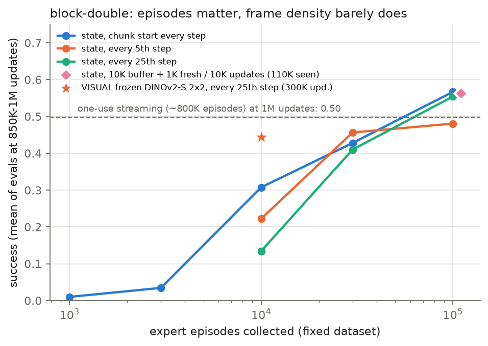
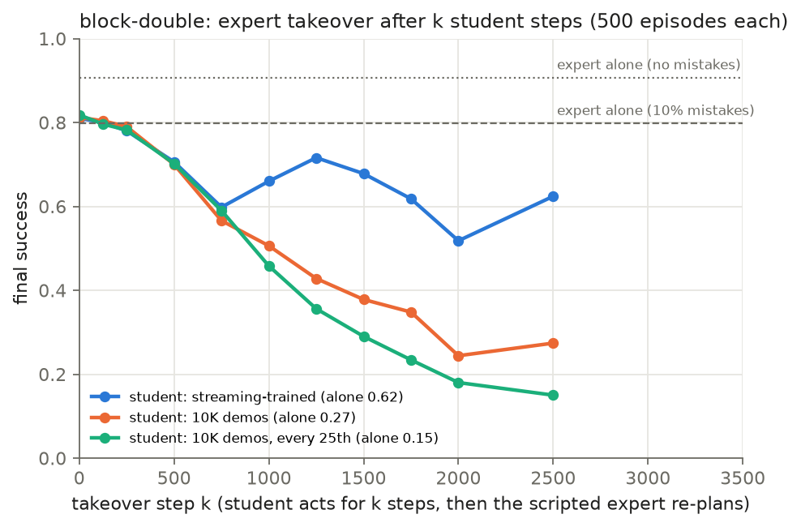

# Part B: block-double

Part of the [visual BC study](README.md). Exact settings: [appendix.md](appendix.md). Per-run table: [runs.csv](runs.csv).

## B1. Data-regime study (state FBC, JAX, handcrafted features, 1M updates)

**Data**: `scripts/collections_store.py` stores 1K-episode collections from the OCBench MJWarp scripted expert,
using the same seeding as the streaming pipeline. Only successful episodes are kept, together with qpos for later
re-rendering. The scripted expert succeeds on 78.9% of collected episodes; a successful episode is 1584 steps on
average.

**Trainer**: `scripts/train_regime.py`.
- A fixed-N run uses collections 0..N/1K−1.
- *start interval k*: chunk starts only at episode steps 0, k, 2k, … (k = 25 matches visual frame availability).
- *replay*: a FIFO buffer of N episodes that receives 1K fresh episodes (collections 1000+) every R updates.

| Run | Buffer episodes | Start interval | Refresh every | Episodes seen | Chunk starts | Success 450–600K | Success 850K–1M |
| --- | ---: | ---: | ---: | ---: | ---: | ---: | ---: |
| `r-fixed-n1k` | 1K | 1 | – | 1K | 1.27M | 0.01 | 0.01 |
| `r-fixed-n3k` | 3K | 1 | – | 3K | 3.7M | 0.03 | 0.03 |
| `r-fixed-n10k` | 10K | 1 | – | 10K | 12.5M | 0.25 | 0.31 |
| `r-fixed-n10k-int5` | 10K | 5 | – | 10K | 2.5M | 0.18 | 0.22 |
| `v-state-double-n10000-int25-s0` | 10K | 25 | – | 10K | 0.7M | 0.13 | 0.13 |
| `r-fixed-n30k` | 30K | 1 | – | 30K | 37.4M | 0.24 | 0.43 |
| `r-fixed-n30k-int5` | 30K | 5 | – | 30K | 7.5M | 0.23 | 0.46 |
| `r-fixed-n30k-int25` | 30K | 25 | – | 30K | 1.5M | 0.27 | 0.41 |
| `r-fixed-n100k` | 100K | 1 | – | 100K | 125M | 0.31 | **0.57** |
| `r-fixed-n100k-int5` | 100K | 5 | – | 100K | 25M | 0.23 | 0.48 |
| `r-fixed-n100k-int25` | 100K | 25 | – | 100K | 5.0M | 0.41 | **0.55** |
| `r-replay-b10k-r10k` | 10K | 1 | 10K | 110K | 12.5M | 0.34 | **0.56** |
| `r-replay-b10k-r2k` | 10K | 1 | 2K | 510K | 12.4M | 0.39 | **0.59** |
| `r-replay-b30k-r5k-int25` | 30K | 25 | 5K | 230K | 1.5M | 0.33 | 0.49 |
| `m4-handcrafted-s0` (Mystery 4) | one-use streaming | 1 | each start used once | ~800K at 1M | – | 0.27 | 0.50 |
| `m1-double-n10000-s0` (Mystery 1) | 10K (`train.py` data) | 1 | – | 10K | 17.8M | 0.18 | 0.23 |

Notes:
- 10K runs overfit: final validation flow loss is 0.09–0.12 at ≤10K episodes vs 0.016 at 100K.
- `v-state-double-n10000-int25-s0` and `m1-double-*` use the older `train.py` dataset (`data/block-double-task1-v0-n10000-d0`),
  not the collection store.

## B2. Expert-alone and takeover diagnostics (`scripts/takeover.py`)

Setup:
- The same initial states are used for every k (evaluation seeding).
- The student acts for k steps with open-loop 25-step chunks, then `BlockMjWarpController` re-plans from the
  current simulator state and acts until the 2500-step horizon.
- The expert's deliberate-mistake probability is configurable via `OCB_MISTAKE_PROB`. This is a local edit in the
  `ocbench` submodule; see `patches/ocbench-mistake-prob.patch`. The default (0.1) is unchanged.

| Expert alone (1000 episodes) | Success |
| --- | ---: |
| default (10% deliberate mistakes per planned move) | 0.798 |
| mistakes disabled | 0.907 |

Final success when the expert takes over at step k (500 episodes per entry). The parenthesis is the rescue rate:
success among episodes still unsolved and alive at k.

| k | `m4-handcrafted-s0-cont2` (alone 0.62) | `m1-double-n10000-s0` (alone 0.27) | `v-state-double-n10000-int25-s0` (alone 0.15) |
| ---: | --- | --- | --- |
| 0 | 0.81 | 0.81 | 0.82 |
| 250 | 0.78 | 0.79 | 0.78 |
| 500 | 0.71 | 0.70 | 0.70 |
| 750 | 0.60 | 0.57 | 0.59 |
| 1000 | 0.66 (0.66) | 0.51 (0.50) | 0.46 (0.46) |
| 1250 | **0.72** (0.71) | 0.43 (0.42) | 0.36 (0.35) |
| 1500 | 0.68 (0.65) | 0.38 (0.35) | 0.29 (0.27) |
| 1750 | 0.62 (0.52) | 0.35 (0.27) | 0.23 (0.20) |
| 2000 | 0.52 (0.27) | 0.24 (0.12) | 0.18 (0.11) |
| 2500 | 0.62 | 0.27 | 0.15 |

The decline at large k mixes "state is unrecoverable" with "not enough time left for the expert's plan". A
follow-up with an extended expert horizon would separate the two.

## B3. Visual policies on visual-block-double and transfer runs (frozen embeddings, 300K updates)

Data: the released visual-block-double dataset (10K episodes, images every 25 steps). `vis_prep.py --no-images`
builds the index only, so frozen-embedding runs do not need the 83 GB 112-px image cache.

| Run | Encoder | Success | Best | Status |
| --- | --- | ---: | ---: | --- |
| `v-state-double-n10000-int25-s0` | state, same data regime | 0.14 | 0.17 | done (1M updates) |
| `v-dbl-dinov2_s-s0` | DINOv2-S CLS | 0.25 | 0.26 | done |
| `v-dbl-dinov2_s_p2-s0` | DINOv2-S 2×2 patches | **0.44** | 0.47 | done |

Transfer runs (`scripts/launch_regime.py --only X`), all on the same data, frozen embeddings,
300K updates:

| Run | Encoder | Success | Best |
| --- | --- | ---: | ---: |
| `v-dbl-random_vit_s-s0` | random ViT-S | 0.00 | 0.00 |
| `v-dbl-resnet50_ce-s0` | ResNet-50 | 0.16 | 0.18 |
| `v-dbl-dinov2_b-s0` | DINOv2-B CLS | 0.32 | 0.35 |
| `v-dbl-clip_b16-s0` | CLIP B/16 | 0.34 | 0.36 |
| `v-dbl-dinov2_s_p4-s0` | DINOv2-S 4×4 patches (needs an A6000: 27 GB of embeddings on GPU) | **0.70** | 0.71 |
| `v-dbl-F-bc-enc-nodr-dinov2s-s0` | DINOv2-S sim-pretrained on 200K two-cube states (no DR, 44-d targets) | **0.80** | 0.83 |

The double encoder's held-out R²: cube-in-camera 0.999, cube-in-gripper 0.998, yaw 0.986, cube xyz 0.999,
pinch 0.999, gripper 0.995, arm 0.824.

## B4. Compute and storage cost of going visual (measured, `scripts/bench_vis_cost.py`)

| Item | Measured |
| --- | --- |
| Expert state collection (MJWarp, 1000 parallel worlds) | 67 s per 1K episodes |
| Collection with OCBench in-loop rendering (3 cams, 224 px), image every 25 steps | 391 s per 1K episodes (state-only at the same batch size: 231 s) |
| 〃, image every 5 steps | 1120 s per 1K episodes |
| Offline re-render from stored qpos (EGL, GPU) | ~456 states/s per process; ~1.1K states/s per GPU with 30 processes |
| Frozen DINOv2-S embedding, 3 cams at 112 px (A5000) | ~1090 frames/s (CLS and patch pooling alike) |
| Training, 1M updates | state 31.8 updates/s (8.7 h); frozen CLS 25/s (11 h); frozen 2×2 patches 20.5/s (13.6 h) |

Per 1K collected episodes:
- 789 successful episodes, 1.25M transitions;
- images every 25 steps → 50K frames; every 5 steps → 250K frames; every step → 1.25M frames.

Storage per frame (3 cameras):

| Format | Bytes per frame | Per 1K episodes, every 25 steps | Per 100K episodes, every 25 steps |
| --- | ---: | ---: | ---: |
| uint8 112 px | 113 KB | 5.7 GB | 565 GB |
| uint8 224 px | 452 KB | 23 GB | 2.3 TB |
| fp16 CLS (384-d) | 2.3 KB | 0.12 GB | 11.6 GB |
| fp16 2×2 patches | 9.2 KB | 0.46 GB | 46 GB |
| fp16 4×4 patches | 37 KB | 1.85 GB | 185 GB |

Implications:
- Frozen-embedding visual BC at the "100K episodes, every 25 steps" regime (state success 0.55) costs about
  4.6 GPU-h of data preparation (collect 1.9 + render 1.4 + embed 1.3) plus 11–14 GPU-h of training.
- One-use streaming with rendering (M4-style, about 1B rendered samples per 1M updates) would cost about
  550 GPU-h: not viable.
- A rolling buffer (10K episodes, refreshed every 10K updates) keeps storage at about 5 GB and adds about 20% to
  training time.
- End-to-end pixel training needs the raw-image cache: about 57 GB for 10K episodes at 112 px.

---

