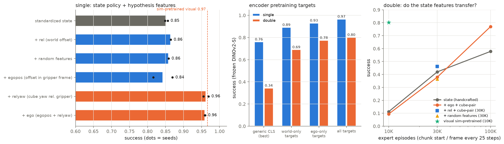

# Part C: why does vision beat privileged state?

Part of the [visual BC study](README.md). Exact settings: [appendix.md](appendix.md). Per-run table: [runs.csv](runs.csv).

## C1. State policy + hypothesis features (`train.py` `Features`, mode `base+extra...`)

Extras are computed from the raw observation:
- 19 proprio dims (effector position at 12:15, effector cos/sin yaw at 15:17), then 9 dims per cube (position,
  quaternion, cos/sin yaw).
- Each extra is z-scored on the training data and appended.

| Extra | Definition |
| --- | --- |
| `rel` | cube − effector (world frame) |
| `egopos` | cube − effector rotated into the effector yaw frame |
| `relyaw` | sin/cos(4·(cube yaw − effector yaw)), i.e. relative yaw under the cube's 90° symmetry |
| `ego` | `egopos` + `relyaw` |
| `pair` | cube_j − cube_0 and its norm (double) |
| `randproj` | control: tanh(W·z), W fixed Gaussian, same width as `ego` |

block-single, collection store (10K episodes, chunk starts every 25 steps), 500K updates (`train_regime.py`):

| Run | Success |
| --- | ---: |
| `h-single-n10k-int25-standardized-s0` / `-s1` | 0.856 / 0.849 |
| `h-single-n10k-int25-standardized_rel-s0` | 0.865 |
| `h-single-n10k-int25-standardized_randproj-s0` | 0.859 |
| `h3-single-n10k-int25-standardized_egopos-s0` / `-s1` | 0.816 / 0.869 |
| `h3-single-n10k-int25-standardized_relyaw-s0` / `-s1` | **0.955 / 0.969** |
| `h-single-n10k-int25-standardized_ego-s0` / `-s1` | **0.960 / 0.959** |

block-double, chunk starts every 25 steps, 1M updates:

| Run | Success |
| --- | ---: |
| `h2-double-n10k-int25-handcrafted-s0` | 0.11 |
| `h2-double-n10k-int25-handcrafted_ego_pair-s0` | 0.09 |
| `r-fixed-n30k-int25` (handcrafted baseline) | 0.42 |
| `h2-double-n30k-int25-handcrafted_ego_pair-s0` | 0.38 |
| `h2-double-n30k-int25-handcrafted_rel_pair-s0` | 0.46 |
| `h2-double-n30k-int25-handcrafted_randproj-s0` | 0.36 |
| `r-fixed-n100k-int25` (handcrafted baseline) | 0.58 |
| `h2-double-n100k-int25-handcrafted_ego_pair-s0` | **0.77** |
| `h-double-n{10,30}k-int25-standardized{,_ego_pair,_randproj,_rel_pair}-s0` (z-scored base; collapses on double) | 0.02 – 0.21 |

## C2. Encoder target ablation (`pretrain_enc.py --groups`)

Same data, schedule and BC as F. Only the regressed target groups differ.

| Encoder | Targets | Held-out R² | BC run | Success |
| --- | --- | --- | --- | ---: |
| `h-sgl-enc-nodr-dinov2s-world` | cube_xyz, pinch_xyz, gripper, arm_qpos | 0.999 / 0.999 / 0.996 / 0.851 | `h-sgl-bc-nodr-dinov2s-world-s0` | 0.89 |
| `h-sgl-enc-nodr-dinov2s-ego` | cube_in_camera, cube_in_gripper, cube_yaw | 0.919 / 0.998 / 0.991 | `h-sgl-bc-nodr-dinov2s-ego-s0` | 0.93 |
| `v-F-enc-nodr-dinov2s` | all | see F | `v-F-bc-enc-nodr-dinov2s-s0` | 0.97 |
| `h-dbl-enc-nodr-dinov2s-world` | world groups (2 cubes) | 0.999 / 0.999 / 0.996 / 0.802 | `h-dbl-bc-nodr-dinov2s-world-s0` | 0.69 |
| `h-dbl-enc-nodr-dinov2s-ego` | egocentric groups (2 cubes) | 1.000 / 0.999 / 0.990 | `h-dbl-bc-nodr-dinov2s-ego-s0` | 0.78 |
| `v-dbl-F-enc-nodr-dinov2s` | all | see B3 | `v-dbl-F-bc-enc-nodr-dinov2s-s0` | 0.80 |

