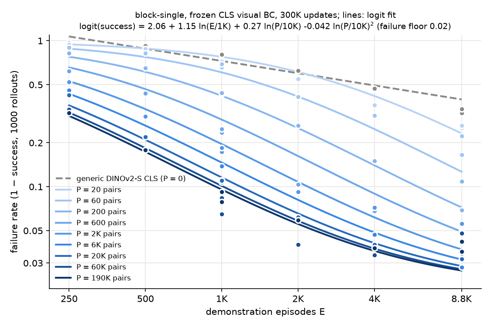

# Follow-up: yaw features, other tasks, and data scaling (W&B group `vision-followup`)

Three questions on top of the main study ([README](README.md)):

- **Q.** Why do sim-pretrained visual features expose `sin/cos(4·(cube yaw − gripper yaw))` when no pretraining target
  contains it?
- **G.** Does "frozen visual encoder beats privileged state" carry over to other OCBench tasks?
- **S.** How does block-single success scale with encoder-pretraining pairs P and demonstration episodes E?
- **R.** Round 3: robustness and recipe checks (pair source, hanoi P scan, appearance shift, hanoi state features,
  fine-tuning, patch readout, low-P replicates).

Launcher: `scripts/launch_gen.py` (`--list` shows every job). Figures and fit: `scripts/report_scaling.py`. Visual BC
here is always the frozen-embedding flow-matching head trained for 300K updates. Every visual number comes from a
**final evaluation of 1000 rollouts**, so the binomial standard error is ≤ 0.016. Seed-to-seed spread is 0.01–0.03.

## Q. Where the 4·Δyaw feature comes from

Probes on cached embeddings: `scripts/yaw_probe.py`, output `results/diagnostics/yaw_probe.jsonl`. Each value is a
held-out R² of a 2-layer MLP probe on all three cameras. The privileged state reaches R² 1.00 on every target.

| Encoder (BC success, block-single) | sin/cos(Δyaw) | sin/cos(4·Δyaw) | sin/cos(4·cube yaw) | gripper yaw |
| --- | ---: | ---: | ---: | ---: |
| generic DINOv2-S CLS (0.65) | < 0 | 0.47 | 0.82 | 0.99 |
| sim-pretrained, world-frame targets (0.89) | < 0 | 0.18 | 0.74 | 1.00 |
| sim-pretrained, egocentric targets (0.93) | < 0 | **0.94** | 0.99 | 0.99 |
| sim-pretrained, all targets (0.97) | < 0 | **0.93** | 0.98 | 1.00 |
| sim-pretrained, all targets **except cube_yaw** (0.93) | < 0 | 0.28 | 0.80 | 1.00 |

- **Images cannot carry Δyaw itself.** The cube is uniformly coloured, so it looks the same under any 90° rotation.
  Only yaw modulo 90°, i.e. the k = 4 harmonic, is visible. Δyaw (k = 1) and 2·Δyaw are undecodable from every
  encoder (R² ≤ 0).
- **The pretraining targets supply it.** The cube-yaw target is encoded as sin/cos(4·yaw), which is the only
  target the images can fit. The gripper's yaw is easy to see, especially from the wrist camera (R² 0.97–0.99).
  - An encoder that represents both 4·cube yaw and gripper yaw smoothly makes 4·Δyaw a simple function of its
    features (MLP R² 0.93–0.94).
  - Remove the cube_yaw target and 4·Δyaw drops to 0.28.
- **The state policy is worse off than the encoder.** The state holds both yaws as raw quaternion or angle values.
  To get the symmetric difference it has to compose yaw extraction, subtraction and a 90°-periodic wrap. That
  function is discontinuous in the raw inputs.
- **The feature helps BC but is not required.**
  - Dropping cube_yaw costs 0.04 (0.97 → 0.93 at 10K demos).
  - Generic 4×4-pooled DINOv2-S reaches 0.90 although a linear probe recovers 4·Δyaw from it only weakly (R² ≤ 0.35). It wins through near-perfect
    cube localization instead (see README §4).

## G. Other OCBench tasks

Visual demonstrations are rendered in-loop with OCBench's own cameras (`scripts/vis_collect.py`, 10K episodes, a
frame every 25 steps). State BC uses handcrafted features, chunk starts every 25 steps, and 500K updates (hanoi-double:
1M). The state numbers are from the last 500-rollout evaluation.

| Task | State, 10K demos | State, 30K demos | Frozen DINOv2-S 4×4 | Frozen sim-pretrained DINOv2-S |
| --- | ---: | ---: | ---: | ---: |
| hanoi-single (success) | 0.528 | 0.548 | 0.963 | **0.996** |
| bowling (return; expert ≈ 0.29) | 0.387 | 0.338 | 0.379 | 0.328 |
| hanoi-double (success) | 0.164 | 0.172 | – | – |

- **hanoi-single replicates block-single, more strongly.**
  - State BC plateaus at about 0.53–0.55, and tripling the data adds only 0.02.
  - Both visual policies are near perfect.
  - Hanoi disks and pegs are square, so the same 90°-symmetric relative yaw problem applies.
  - hanoi-single task1 has fixed pegs. Their targets are constant, so the encoder is pretrained without peg targets
    (`--exclude-groups peg_xyz,peg_yaw`). Its held-out R² is 0.993.
- **bowling shows no visual advantage.**
  - All four policies score 0.33–0.39, above the scripted expert's 0.29, and the differences are within noise.
  - Bowling has no success flag; the score is the episode return (0.1 per pin). Training therefore keeps every
    demonstration.
- **hanoi-double state BC is weak** (0.16–0.17 at 1M updates). Per the decision to stop at hanoi-single, the visual
  pipeline was not run here.

## S. Scaling with pretraining pairs P and demonstration episodes E (block-single)



Setup:
- **Encoders** `s-sgl-enc-p{20,60,200,600,2k,6k,20k,60k,190k}`: DINOv2-S trained on the first P rendered (image,
  state) pairs of the 200K-pair file.
  - The pairs are perturbed simulator states, not the demonstrations themselves: half get a re-placed cube, all get
    arm and gripper noise.
  - The checkpoint is chosen by held-out R² (evaluated every 2K steps of 40K). **P = 0** is generic DINOv2-S (CLS
    token).
- **BC** trains on the first E successful demos, from a fixed permutation, so the subsets are nested. E = 8818 means
  all successful demos.
- E = 1K and 8.8K have two seeds for P ≥ 2K, shown as s0 / s1. For P ≤ 600 the second value at E = 1K and 8.8K is a
  full replicate: a freshly rendered pair file (`dr_gen --seed 1`), a new encoder (`--seed 1`) and BC seed 1
  (runs `s-sgl-bc-p{P}-r1-*`).

Success, 1000-rollout final evaluation. The last column is the encoder's held-out R² averaged over all targets:

| P \ E | 250 | 500 | 1K | 2K | 4K | 8.8K | enc. R² |
| --- | ---: | ---: | ---: | ---: | ---: | ---: | ---: |
| 0 (generic CLS) | 0.029 | 0.075 | 0.187 / 0.197 | 0.377 | 0.530 | 0.680 / 0.659 | – |
| 20 | 0.057 | 0.117 | 0.330 / 0.278 | 0.453 | 0.637 | 0.746 / 0.738 | −0.04 / −0.07 |
| 60 | 0.101 | 0.180 | 0.341 / 0.306 | 0.586 | 0.692 | 0.835 / 0.777 | 0.21 / 0.20 |
| 200 | 0.179 | 0.349 | 0.568 / 0.559 | 0.738 | 0.850 | **0.891** / 0.931 | 0.51 / 0.54 |
| 600 | 0.382 | 0.563 | 0.765 / 0.751 | 0.896 | 0.932 | 0.948 / 0.945 | 0.79 / 0.79 |
| 2K | 0.478 | 0.697 | 0.826 / 0.815 | 0.908 | 0.928 | 0.944 / 0.950 | 0.90 |
| 6K | 0.542 | 0.776 | 0.889 / 0.862 | 0.939 | 0.953 | 0.951 / 0.972 | 0.94 |
| 20K | 0.576 | 0.780 | 0.893 / 0.890 | 0.938 | 0.960 | 0.965 / 0.968 | 0.95 |
| 60K | 0.662 | 0.821 | 0.935 / 0.916 | 0.960 | 0.966 | 0.965 / 0.952 | 0.96 |
| 190K | 0.680 | 0.822 | 0.908 / 0.921 | 0.941 | 0.962 | 0.958 / 0.964 | 0.97 |

For reference, ground-truth-state BC on 10K demos reaches 0.85.

**Replicates.** Re-rendering the pairs and retraining the encoder moves low-P cells by 0.003–0.058 (mean 0.027),
in both directions. That is about twice the BC seed spread, so single low-P cells carry about ±0.04 of noise from
which pairs were drawn. Encoder R² reproduces within 0.03.

**Fit.** Over all 72 runs with P > 0, success is well described by a logit law that is additive in ln E and
concave in ln P. The residual RMSE is 0.034, largest at the lowest P:

```
logit(success) = 2.06 + 1.15 ln(E/1K) + 0.27 ln(P/10K) − 0.042 ln(P/10K)²      (failure floor 0.02)
```

- The interaction term ln E · ln P comes out at about 0 (it was dropped). In odds, demos and pairs therefore
  multiply: odds ∝ E^1.18 · g(P).
- The P slope, 0.27 − 0.084·ln(P/10K), is about 0.8 per e-fold at P = 20 and about 0.02 at P = 190K: strongly
  diminishing returns.
- The earlier power law, `fail = 0.023 + (0.047 + 0.053 (P/10K)^-0.27) (E/1K)^-1.01`, fits the P ≥ 2K cells better
  (RMSE 0.015). It badly overestimates failure below 2K pairs (RMSE 0.14 over all P). Below 2K pairs the E slope of
  the failure rate flattens, which the logit form captures.

Findings:
- **Even 20 pairs help.** The P = 20 encoder's held-out R² is below 0, yet with all demos its policy beats generic
  CLS (0.75 vs 0.67). It is above generic CLS at every E.
- **About 200 pairs give 0.9 with all demos (0.891 / 0.931); about 600 pairs give 0.9 already at 2K demos (0.896).**
  2K–6K pairs reach 0.94–0.97 with all demos.
- **Pairs pay most when demos are scarce.** At E = 250, success goes from 0.06 (20 pairs) to 0.38 (600) to 0.68
  (190K). With all demos, everything from 600 pairs up lies within 0.95 ± 0.02.
- **Above about 20K pairs, extra pairs are within seed noise for E ≥ 1K.**
- **Failure falls roughly as 1/E at high P,** toward a floor of about 2–3%. That floor may be set by the scripted
  expert's own quality.
- **A sim-pretrained encoder with 600 pairs plus 1K demos (0.77) beats generic CLS on all 8.8K demos
  (0.67–0.68),** with an eighth of the demos. With 2K pairs and 1K demos it is on par with 10K-demo ground-truth state
  (0.82 vs 0.85).
- **Cost.** Each BC run takes 3–8 GPU-h depending on the GPU (300K updates). Low-P encoders pick their best
  checkpoint at the first evaluation (2K steps); more steps only overfit.

## R. Round 3: robustness and recipe checks

All visual numbers are 1000-rollout final evaluations of frozen-embedding BC (300K updates) and a single seed unless
noted. Launcher groups X1–X7 in `scripts/launch_gen.py`.

### R1. Pairs rendered from states unrelated to the demos (block-single)

`dr_gen --states uniform`: arm joints uniform within the demos' 1–99% joint range, cubes uniform on the table with
random yaw, and in 25% of pairs the first cube placed in the gripper. No demo state is used. Runs
`x1-sgl-{enc,bc}-uni-*`.

| P | E = 1K, uniform / demo-perturbed | E = 8.8K, uniform / demo-perturbed |
| --- | ---: | ---: |
| 200 | 0.586 / 0.568, 0.559 | 0.922 / 0.891, 0.931 |
| 2K | 0.797 / 0.826, 0.815 | 0.942 / 0.944, 0.950 |
| 20K | 0.861 / 0.893, 0.890 | 0.947 / 0.965, 0.968 |

- **Pairs do not need to come from demo states.** Uniform pairs land within noise at P ≤ 2K and 0.02–0.03 lower at
  20K pairs.
- The small gap at 20K pairs is consistent with uniform states spending capacity on configurations the policy never
  visits.

### R2. Pairs scan on hanoi-single

Same recipe as block (encoder without peg targets), E = 1K or all 9962 successful demos. Runs `x2-hs-*`.

| Encoder | enc. R² | E = 1K | E = 9962 |
| --- | ---: | ---: | ---: |
| generic DINOv2-S 4×4 | – | 0.393 | 0.963 |
| sim-pretrained, P = 200 | 0.73 | 0.940 | **0.998** |
| sim-pretrained, P = 2K | 0.91 | 0.980 | 0.993 |
| sim-pretrained, P = 20K | 0.96 | 0.984 | 0.994 |
| sim-pretrained, P = 190K | 0.99 | 0.989 | 0.996 |

- **The pairs lever is even stronger on hanoi.** With 1K demos, 200 pairs lift success from 0.39 to 0.94.
- With all demos every sim-pretrained encoder is at 0.99–1.00; from 2K pairs on, 1K demos suffice for 0.98.

### R3. Appearance shift at evaluation (block-single, all demos)

`train_vis --shift-eval`: 500 rollouts per mode. Each episode draws one appearance from the same ranges the DR
pretraining used (`vis_common.Appearance`) and keeps it for the whole episode: object/table/robot colours,
lighting, and camera pose jitter. "All" applies the three together.

| Encoder | nominal | colour | light | camera | all |
| --- | ---: | ---: | ---: | ---: | ---: |
| sim-pretrained, no DR | 0.962 | 0.012 | 0.216 | 0.468 | 0.000 |
| **sim-pretrained, DR pairs** | 0.942 | **0.838** | **0.628** | **0.738** | **0.424** |
| generic DINOv2-S 4×4 | 0.896 | 0.000 | 0.002 | 0.020 | 0.000 |

- **DR in pretraining is what makes the policy survive appearance change.** Without it, a colour change alone drops
  success to about 0. The nominal-appearance cost of DR is 0.02.
- **The frozen generic encoder is the most brittle.** The 4×4 patch policy collapses under every shift. The BC head
  is trained on fixed appearance and keys on features that move with colour and lighting.
- Lighting and the combined shift remain the hardest; DR pretraining alone does not close the gap.

### R4. State BC with the relative-yaw feature on hanoi-single

`train.py --extra diskyaw` adds sin/cos(4·(disk yaw − gripper yaw)) per disk, the feature that rescued block-single
state BC (README §3). Runs `x4-hs-state-diskyaw-*`, 500K updates, last 500-rollout evaluation.

| Demos | handcrafted | + diskyaw |
| --- | ---: | ---: |
| 10K | 0.528 | 0.458 |
| 30K | 0.548 | 0.530 |

- **It does not help on hanoi.** State BC stays at about 0.5, so on hanoi the relative disk yaw is not the
  bottleneck. The visual policies (0.96–1.00) win for a different reason, which this study did not isolate.

### R5. Fine-tuning a low-P encoder end-to-end

PENDING

### R6. 4×4 patch readout of the sim-pretrained encoder

The BC head reads 4×4 average-pooled patch tokens of the sim-pretrained encoder instead of its CLS token. Runs `x6-*`.

| Task, E | CLS | 4×4 patches |
| --- | ---: | ---: |
| block-single, P = 2K, E = 250 | 0.478 | 0.348 |
| block-single, P = 2K, E = 1K | 0.826 / 0.815 | 0.817 |
| block-single, P = 190K, E = 250 | 0.680 | 0.331 |
| block-single, P = 190K, E = 1K | 0.908 / 0.921 | 0.853 |
| block-double, all demos | 0.80 | 0.824 |

- **Patches hurt when demos are scarce** (−0.13 to −0.35 at E = 250). The likely reason: pretraining regresses
  the state targets from the CLS token only, so the patch tokens are not shaped by it, and the 16× wider input gives
  the BC head more to overfit.
- On block-double with all demos the patches are slightly better (+0.02), within noise of the README number.

### R7. Low-P replicates

See the replicate columns in the S table above.

## Takeaways

1. A sim-pretrained frozen encoder is the main lever. Even a few hundred rendered pairs are worth more than a
   generic encoder, and 2K pairs plus 1K demos matches 10K-demo state BC.
2. About 200 pairs reach 0.9 with all demos; 2K–20K pairs reach the plateau. Beyond that, spend on demos.
3. Demos still matter. At high P, failure falls as about 1/E down to about 2–3%; 4K demos get within about 0.01 of
   all 8.8K.
4. The visual advantage is task dependent. It is large on block and hanoi and absent on bowling. On hanoi the
   relative-yaw feature does not fix state BC, so symmetry is not the whole story there.
5. Pairs need not come from demo states: uniformly sampled scene states work as well up to 2K pairs.
6. For robustness to appearance change, render the pairs with domain randomization. It costs 0.02 at nominal
   appearance and keeps 0.42–0.84 success under shifts where the other encoders score about 0.
7. Read the sim-pretrained encoder's CLS token, not its patch tokens.

## Notes

- **Runs:** `runs/{q,g,s,x1..x7}-*`. BC checkpoints are deleted after the final evaluation (`--drop-ckpt`), except
  the three R3 runs. Fit and raw
  numbers: [figures/scaling_single.json](figures/scaling_single.json).
- **Compute:** run on `deepaklong` and `all`. Frozen-embedding BC runs on cheap GPUs (2080 Ti at
  9.9 updates/s, RTX 6000 at 11, A5000 at 26).
- **Cluster incidents:**
  - A Slurm database outage on 2026-11-18 killed 15 runs; they resumed from checkpoints.
  - Two 2080 Ti nodes (grogu-3-20/30) fail CUDA initialization, and JAX silently falls back to CPU there. Exclude
    them.
