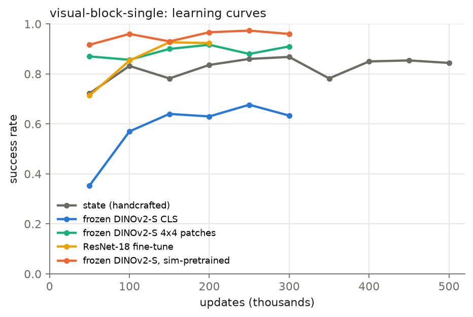
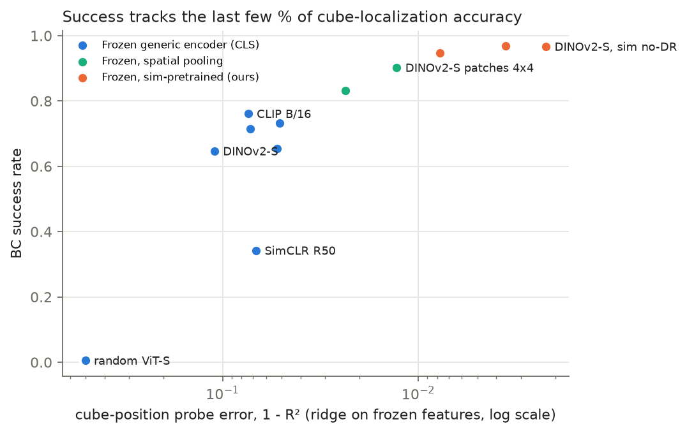
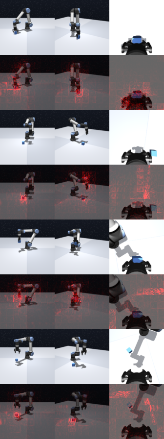

# Part A: visual-block-single

Part of the [visual BC study](README.md). Exact settings: [appendix.md](appendix.md). Per-run table: [runs.csv](runs.csv).

## A. State baselines (JAX FBC, 10K demos, chunk starts every 25 steps = the visual frames, 500K updates)

| Run | Features | Success | Best |
| --- | --- | ---: | ---: |
| `v-state-single-n10000-int25-s0` | handcrafted | 0.85 | 0.87 |
| `v-state-single-standardized-n10000-int25-s0` | z-score | 0.85 | 0.89 |
| `v-state-single-xyz0.1-n10000-int25-s0` | z-score, xyz ×0.1 | 0.82 | 0.85 |
| `v-state-single-xyz10-n10000-int25-s0` | z-score, xyz ×10 | 0.87 | 0.90 |
| `v-state-single-fourier4-n10000-int25-s0` | z-score + Fourier(1,2,4,8) | 0.86 | 0.88 |

Reference: Mystery-1 single-task run with all chunk starts and 2M updates, 89.2% ([RESULTS.md](../../RESULTS.md)).

## B. Frozen pretrained encoders (CLS / global feature, 300K updates)

| Run | Encoder | Feature dim × 3 cams | Success | Best |
| --- | --- | --- | ---: | ---: |
| `v-B-random_vit_s-s0` | ViT-S/16, random init | 384 | 0.01 | 0.01 |
| `v-B-simclr_r50-s0` | ResNet-50 SimCLR | 2048 | 0.34 | 0.37 |
| `v-B-dinov2_s-s0` | DINOv2 ViT-S/14 | 384 | 0.65 | 0.68 |
| `v-B-resnet50_ce-s0` | ResNet-50 ImageNet classification | 2048 | 0.65 | 0.67 |
| `v-B-dinov2_b-s0` | DINOv2 ViT-B/14 | 768 | 0.71 | 0.75 |
| `v-B-mae_b16-s0` | MAE ViT-B/16 | 768 | 0.73 | 0.76 |
| `v-B-clip_b16-s0` | CLIP ViT-B/16 | 512 | 0.76 | 0.79 |

## C. Embedding scale and spatial readout

| Run | Variant | Success | Best |
| --- | --- | ---: | ---: |
| `v-C-dinov2_b-raw-s0` | DINOv2-B, raw features | 0.69 | 0.71 |
| `v-B-dinov2_b-s0` | DINOv2-B, standardized | 0.71 | 0.75 |
| `v-C-dinov2_b-x0.1-s0` | DINOv2-B, standardized ×0.1 | 0.75 | 0.77 |
| `v-C-dinov2_b-x10-s0` | DINOv2-B, standardized ×10 | 0.78 | 0.80 |
| `v-C-dinov2_s_p2-s0` | DINOv2-S, patch tokens average-pooled 2×2 | 0.83 | 0.88 |
| `v-C-dinov2_s_p4-s0` | DINOv2-S, patch tokens average-pooled 4×4 | **0.90** | 0.92 |

## D. End-to-end visual encoders (pixels at 112 px, batch 256, 200K updates)

| Run | Encoder | Success | Best |
| --- | --- | ---: | ---: |
| `v-D-impala-scratch-s0` | Impala CNN from scratch | 0.86 | 0.89 |
| `v-D-resnet18-ft-s0` | ResNet-18 ImageNet, fine-tuned | 0.90 | 0.93 |
| `v-D-dinov2_s-ft-s0` | DINOv2-S, fine-tuned at encoder learning rate 1e-5 | 0.88 | 0.95 |

## E. Auxiliary state regression (predict qpos from the observation features, labelled fraction of episodes)

| Run | Base | Aux fraction | Success | Best |
| --- | --- | ---: | ---: | ---: |
| `v-E-dinov2_b-adapter-aux0-s0` | frozen DINOv2-B + trainable adapter | 0 | 0.60 | 0.64 |
| `v-E-dinov2_b-adapter-aux0.01-s0` | 〃 | 1% | 0.58 | 0.58 |
| `v-E-dinov2_b-adapter-aux0.1-s0` | 〃 | 10% | 0.61 | 0.62 |
| `v-E-dinov2_b-adapter-aux1-s0` | 〃 | 100% | 0.61 | 0.62 |
| `v-D-impala-scratch-s0` | Impala end-to-end | 0 | 0.86 | 0.89 |
| `v-E-impala-aux0.01-s0` | 〃 | 1% | 0.82 | 0.91 |
| `v-E-impala-aux0.1-s0` | 〃 | 10% | 0.69 | 0.78 |
| `v-E-impala-aux1-s0` | 〃 | 100% | 0.70 | 0.77 |

## F. Encoder pretraining on simulated (image, state) pairs, then frozen BC

**Data** (`scripts/dr_gen.py`, 200K states, about 6 min on 30 CPU workers):
- States are sampled from the demonstration qpos.
- In 50% of samples the cube is re-placed uniformly over the demo xy range with a random yaw.
- Arm joints get N(0, 0.05 rad) noise, and the gripper opening is uniform.
- Each state is rendered twice:
  - `nodr`: nominal appearance;
  - `dr`: random geom/material colors, light/headlight changes, camera position ±2 cm (wrist ±0.5 cm) and
    orientation ±3° (wrist ±1.5°).

**Targets** (27-d, standardized):
- cube position in each camera frame (9);
- cube position in the gripper/pinch frame (3);
- sin/cos of 4 × cube yaw (2);
- pinch xyz (3), gripper opening (1), arm joints (6), cube world xyz (3).

**Pretraining** (`scripts/pretrain_enc.py`): timm backbone shared across the 3 cameras + MLP head. AdamW, head
learning rate 3e-4, backbone 5e-5, cosine schedule, 40K steps, batch 128. The last 5% of samples are held out.

| Encoder run | Init | Data | Held-out R²: cube-in-camera / cube-in-gripper / yaw / pinch / arm | BC run | Success | Best |
| --- | --- | --- | --- | --- | ---: | ---: |
| `v-F-enc-nodr-dinov2s` | DINOv2-S | nodr | 0.926 / 0.998 / 0.987 / 0.999 / 0.848 | `v-F-bc-enc-nodr-dinov2s-s0` | **0.97** | 0.97 |
| `v-F-enc-dr-dinov2s` | DINOv2-S | dr | 0.988 / 0.980 / 0.963 / 0.997 / 0.840 | `v-F-bc-enc-dr-dinov2s-s0` | **0.97** | 0.97 |
| `v-F-enc-dr-resnet18` | scratch | dr | 0.978 / 0.966 / 0.907 / 0.995 / 0.847 | `v-F-bc-enc-dr-resnet18-s0` | 0.95 | 0.96 |

## Linear probes (ridge, frozen features → demo state), `scripts/embed_probe.py`

| Encoder | Mean R² (arm, gripper, cube) | Cube xyz R² | BC success |
| --- | ---: | ---: | ---: |
| random ViT-S | 0.479 | 0.497 | 0.01 |
| SimCLR R50 | 0.873 | 0.933 | 0.34 |
| DINOv2-S | 0.851 | 0.890 | 0.65 |
| ResNet-50 | 0.879 | 0.947 | 0.65 |
| DINOv2-B | 0.880 | 0.928 | 0.71 |
| MAE ViT-B | 0.906 | 0.949 | 0.73 |
| CLIP B/16 | 0.853 | 0.926 | 0.76 |
| DINOv2-S 2×2 | 0.909 | 0.976 | 0.83 |
| DINOv2-S 4×4 | 0.937 | 0.987 | 0.90 |
| sim-pretrained ResNet-18 (DR) | 0.931 | 0.992 | 0.95 |
| sim-pretrained DINOv2-S (DR) | 0.942 | 0.996 | 0.97 |
| sim-pretrained DINOv2-S (no DR) | 0.945 | 0.998 | 0.97 |

## Saliency

`scripts/saliency.py` computes |∂‖a‖²/∂pixel| on 256 held-out frames with fixed flow noise.

`cube_ratio` = mean saliency on (dilated) cube pixels ÷ mean saliency over the image. A value of 1 means no cube
preference. For pooled-patch policies the ratio is less meaningful, because their features are spatial averages.

| Run | front | side | wrist |
| --- | ---: | ---: | ---: |
| `v-F-bc-enc-nodr-dinov2s-s0` | **5.69** | **5.81** | 2.34 |
| `v-D-dinov2_s-ft-s0` | 4.43 | 4.63 | 2.81 |
| `v-D-impala-scratch-s0` | 2.38 | 2.45 | 3.92 |
| `v-F-bc-enc-dr-dinov2s-s0` | 1.99 | 2.39 | 2.05 |
| `v-D-resnet18-ft-s0` | 1.47 | 1.55 | 1.79 |
| `v-B-dinov2_b-s0` | 1.25 | 1.31 | 0.84 |
| `v-B-clip_b16-s0` | 1.25 | 1.08 | 1.08 |
| `v-B-simclr_r50-s0` | 0.37 | 0.46 | 0.46 |
| `v-C-dinov2_s_p4-s0` | 0.39 | 0.36 | 0.56 |

Example frames (rows: image, saliency overlay) for the sim-pretrained policy:

All saliency JSON/PNG files are in `results/diagnostics/saliency/` (repository root).

---

