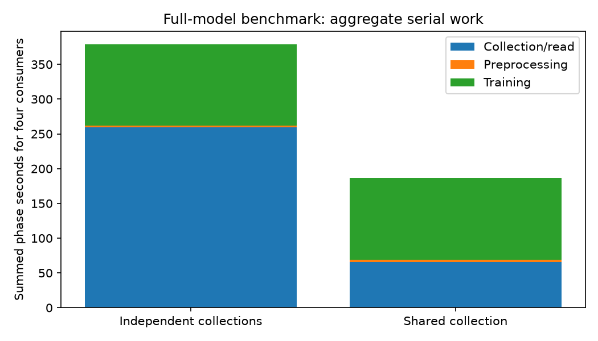

# Shared demonstration cache performance

[Results](../../RESULTS.md) · [Exact measurements](measurements.jsonl) · [Computed analysis](summary.json)

One isolated A6000 executed four feature consumers independently, then four sharing one raw collection. Each consumer trained the full model for 1,024 updates at batch 1,024, with unique transition starts and unchanged float32 network computation. Executable warm-up occurred before both arms.

| Measurement | Result |
| --- | ---: |
| Four independent consumers, summed collection/preprocessing/training | 379.04s |
| Four shared consumers, including one generation | 186.90s |
| Measured reduction in serial work | 2.03× |
| Median fresh collection | 63.92s |
| Median shared-cache read | 0.287s |
| Raw collection including validation | 0.371GB |

**The serial-work speedup is not a measured four-GPU wall-time speedup.** Synchronized readers can all wait on one cache miss. A separate producer is required to overlap generation with training. Based on measured collection and training times, the idealized steady overlap improvement with one additional producer GPU is approximately 1.47×; sustained production throughput remains to be measured.

All four shared consumers received identical raw-array SHA-256 hashes. Feature transformations remain separate and each run uses its transition starts once. Full-size updates completed with finite losses. Cached entries are deleted after all four variants read them; an 80GB decimal cap covers payloads and in-flight reservations. Existing fixed data is approximately 3.40GB logical (2.5GiB allocated). A full cache falls back to ordinary collection. Producer lookahead is 24 collections; two independent producers are submitted on demand for future seed groups, and it releases its allocation after prolonged budget/no-consumer waits.

With two independent producer GPUs, the same idealized overlap model projects 2.95× relative to serial per-run generation. This is a projection; four-way prefill and live production throughput are reported separately.

The currently running seed-0 workers retain their original execution. Their checkpoints lack exact sampler state; they were preserved. Future workers load the shared-cache implementation and locally configured producer automatically. No precision, batch-size, update-horizon, or collection-size change was applied.

## Demonstration scale

The [blog](https://seohong.me/blog/behavioral-cloning-mystery/) uses block-double 10K and block-single 10K/50K for Mystery 1; Mystery 4 consumes a fresh stream. Our saved double10K raw state/action dataset is 3.2945GB. With the single-task 1,250-step episode cap, state/action-only upper bounds are approximately 1.86GB for 10K and 9.32GB for 50K. Streaming 2M updates at batch 1,024 uses roughly 2.05B transition starts, corresponding to hundreds of GB cumulatively per seed; the cache is a moving window rather than a complete stored stream.

A reader on the production training node loaded the same entry in 0.406s with an identical SHA-256; see [cross-node evidence](cross-node-read.json).

[W&B performance comparison](https://forge.coreweave.com/wandb/yzchhr/ocbench-bc-mysteries-1-4/runs/cache-ef6d2399e1e91fa2)

## Storage and private launches

The completed prefill contains 36 collections: 11.89GB cached and 15.29GB total demonstration data including fixed datasets. Cache accounting matches all manifests, with no remaining write reservations.
Five submitted jobs were verified through scheduler accounting and local modes: random labels/work paths, owner-only launchers/directories, and an owner-only workspace. Administrators retain access. See the [storage/privacy audit](storage-and-privacy-audit.json).

## Four-GPU prefill

Four independent one-GPU jobs completed 32 collection requests: 28 fresh generations and 4 cache reuses. The start-to-final-finish span was 579s, including staggered allocation starts. Fresh-generation work summed to 1765s, yielding 3.05× serial-work throughput during this phase. This measures collection parallelism, not learner wall time.
[Exact per-collection records](parallel-prefill.jsonl) · [Parallel analysis](parallel-prefill-summary.json)
