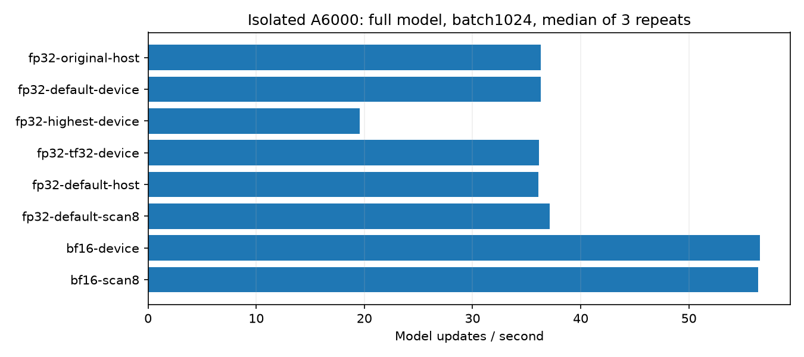

# Isolated A6000 profiling

[Results](../../RESULTS.md) · [Exact timings](training.jsonl) · [Analysis and trace aggregates](summary.json)

Full 136,179,887-parameter model, batch1024, three timed repeats after warm-up. Raw traces and telemetry remain local.

| Case | Median updates/s | Relative speed | Approximate dense MFU |
| --- | ---: | ---: | ---: |
| fp32-original-host | 36.29 | 1.000× | 39.2% |
| fp32-default-device | 36.30 | 1.000× | 39.2% |
| fp32-highest-device | 19.58 | 0.540× | 42.3% |
| fp32-tf32-device | 36.13 | 0.996× | 39.0% |
| fp32-default-host | 36.08 | 0.994× | 39.0% |
| fp32-default-scan8 | 37.16 | 1.024× | 40.1% |
| bf16-device | 56.58 | 1.559× | 30.6% |
| bf16-scan8 | 56.43 | 1.555× | 30.5% |

MFU values use analytical dense-matrix FLOPs and precision-dependent dense peaks from the [NVIDIA GA102 whitepaper](https://www.nvidia.com/content/PDF/nvidia-ampere-ga-102-gpu-architecture-whitepaper-v2.1.pdf). They are estimates, not hardware-counter measurements. The denominator changes with precision, so a faster BF16 case can have lower MFU. Raw XLA cost analysis omits substantial library/loop work and must not be used to infer MFU.

Synthetic repeated-batch tests isolate the update loop. They omit real sampling and simulation, and finite losses do not prove task-learning equivalence. The simulator sweep has one observation per setting and includes per-call setup. Larger collections change collection count and are throughput benchmarks only.

| Collection episodes | Parallel cap | Seconds | Episodes/s |
| ---: | ---: | ---: | ---: |
| 1000 | 512 | 115.28 | 8.67 |
| 1000 | 1024 | 63.33 | 15.79 |
| 2500 | 2500 | 88.08 | 28.38 |

[W&B profiling comparison](https://forge.coreweave.com/wandb/yzchhr/ocbench-bc-mysteries-1-4/runs/profile-53ccf42e4caae64d)
