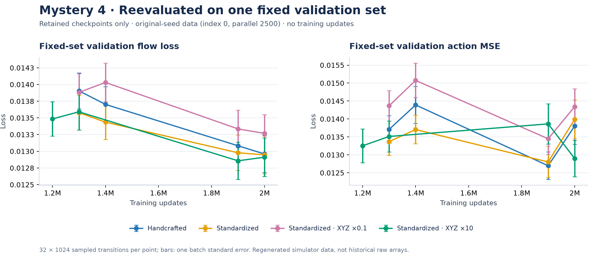

# M4 validation discontinuity audit

Streaming recovery regenerated validation data: collection index 0 became 3072. The first three conditions resumed at 1.4M; XYZ×10 resumed at 1.3M. Validation scores are diagnostics only: they do not update weights, choose checkpoints, or control the constant Adam learning rate.

All saved model/Adam/agent-RNG tensors survive deserialization exactly. Boundary checkpoint hashes match the recorded resume configuration, step counters match, and observation/action preprocessing is unchanged. These checks support correct checkpoint restoration; they do not claim an identical uninterrupted training-data/sampler trajectory.

The validation-set change is confirmed by the executed code and run configuration. Same-checkpoint measurements below demonstrate dataset sensitivity; they cannot assign an exact fraction of the historical jump because the original raw validation arrays were not retained. No checkpoint-loading defect has been found, and a validation-only change does not justify rerunning training.

## Controlled same-checkpoint comparison

Each row below evaluates the SAME boundary model on seed-regenerated index-0 and index-3072 validation sets at the SAME parallelism (2500), with 32 batches of 1024 transitions and fixed sampling/noise keys. The final column reevaluates the 2M model on the SAME index-0 set (parallel 2500). No training is rerun.

| Condition | Boundary | Boundary: index 0 flow | Boundary: index 3072 flow | Set-only change | 2M: index 0 flow |
| --- | ---: | ---: | ---: | ---: | ---: |
| handcrafted | 1,400,000 | 0.01370 | 0.01555 | +13.5% | 0.01296 |
| standardized | 1,400,000 | 0.01344 | 0.01543 | +14.9% | 0.01295 |
| xyz0.1 | 1,400,000 | 0.01403 | 0.01590 | +13.3% | 0.01327 |
| xyz10 | 1,300,000 | 0.01359 | 0.01573 | +15.8% | 0.01291 |

## Fixed-set checkpoint comparison

This figure evaluates every retained checkpoint on one shared original-seed validation dataset (index 0, parallel 2500). Points are actual reevaluations; lines only connect retained checkpoints. Error bars are one Monte Carlo batch standard error, not uncertainty across training seeds.

## What can be repaired

Reevaluation makes the retained checkpoint comparison use a consistent validation set. It does not require retraining merely because validation changed. The dense historical validation curve cannot be corrected exactly: the runner retained only the latest two checkpoints per segment, plus migration snapshots, and the original raw validation arrays were not pinned. Do not interpolate reevaluated points and present them as historical measurements. Robot rollout success is a separate measurement and has not been replaced.

The first three runs also changed simulator collection parallelism from 512 to 2500; XYZ×10 already used 2500. The audit includes index-0 datasets at both settings to separate this implementation change from the seed/split change. Regenerated data can differ from historical data because of simulator/GPU numerical variation; this audit does not claim historical byte identity.

## Prevention

New training processes atomically save the actual raw validation arrays as validation.npz. Migration bundles copy those arrays with a SHA-256 checksum, and resumed training reuses them rather than regenerating a held-out set. Existing running processes cannot retroactively recover an already lost dataset.

## Files and reproduction

[All measurements](m4-validation-audit.jsonl) · [Dataset/protocol metadata](m4-validation-audit-metadata.json). Each published per-condition NPZ also contains these measurements under `audit__*`, separate from the original `history__*` arrays.

Teammates can recreate every figure, including the fixed-set audit, from the five published NPZ files with `.venv/bin/python scripts/plot_from_npz.py --data results/plot-data --output .local/recreated-plots`. Filter `audit__validation_set == "original2500"` and plot `audit__flow_loss` against `audit__checkpoint_step` for direct NumPy access.

Run `source scripts/env.sh` and `.venv/bin/python scripts/audit_m4_validation.py` inside a GPU allocation; then `.venv/bin/python scripts/report_m4_validation_audit.py`. Raw regenerated validation datasets stay local; scalar diagnostics are public.
